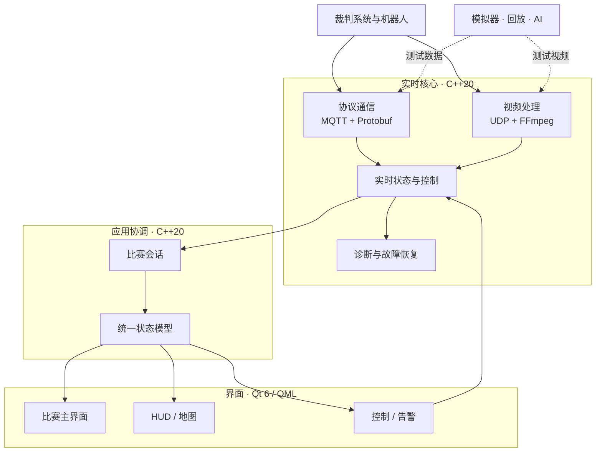

# PIP-Client 技术栈与模块架构

## 目标

PIP-Client 面向 RoboMaster 2027 正式比赛，优先保证高性能、高实时性、低延迟和长期稳定运行，同时保持界面易扩展、后端易读易维护。

协议以 [2027 V1.0.0（20261029）](protocol_2027.md) 为准。目前已有 Protobuf 定义、
C++ 代码生成、通用 MQTT 接收/解析和 QML 状态通知，详见 [数据链路](data_pipeline.md)。
业务 topic、字段映射、比赛状态模型和 UI 布局尚未设计；视频和控制模块为目标架构。

## 已确定技术栈

| 层级 | 技术 | 职责 |
| --- | --- | --- |
| 系统语言 | C++20 | 实时核心、通信、视频、状态、控制和系统能力 |
| 桌面框架 | Qt 6 | 原生窗口、桌面集成和跨平台能力 |
| 界面技术 | QML / Qt Quick | 比赛界面、HUD、地图和布局扩展 |
| 官方数据协议 | Protobuf 3 | 消息序列化与反序列化 |
| 官方通信协议 | MQTT | 比赛状态和控制指令传输 |
| 图传接收 | 原生 UDP | 接收官方图传码流 |
| 视频后端 | FFmpeg | UDP 图传处理、HEVC 解码、缓存、丢帧和异常处理 |

## 开发环境

- **目标开发平台**：Windows 11。
- **主力 IDE**：JetBrains CLion，负责 C++20、CMake、实时核心、协议、FFmpeg、测试和调试。
- **Qt/QML 工具**：Qt Creator，负责 QML 页面、Qt Quick 调试和 Qt Kit 验证。
- **编译器**：Qt 6.9.0 配套的 MinGW 13.1 (`E:/Qt/Tools/mingw1310_64/bin/`)。
- **CMake 生成器**：`MinGW Makefiles`。这是当前路径包含 `$` 时与 Qt 6.9 QML 自动规则兼容的构建方式。
- **工具分工**：CLion 作为主要工程入口，Qt Creator 作为 Qt/QML 专项工具；两者使用同一套 CMake 工程和 Qt 配置。

外围的模拟器、回放工具和 AI 分析工具不属于正式比赛主链路，通过稳定的数据边界提供测试或扩展能力。

## 高层架构

## 本地文件架构

```text
PIP-Client/
├── CMakeLists.txt
├── cmake/                  # CMake 公共配置
├── src/
│   ├── main.cpp            # 应用入口
│   ├── app/                # 应用启动与比赛会话
│   ├── core/               # 当前包含 data_pipeline；视频、控制等尚未接入
│   ├── application/        # 核心模块与界面协调
│   └── platform/           # Windows 平台能力
├── proto/                  # 2027 自定义终端收发消息
├── ui/                     # QML 页面、HUD、地图、控制和样式
├── resources/              # 配置、协议资源、图标和字体
├── tests/                  # 单元、集成、协议和夹具
├── tools/                  # 模拟器、回放和诊断工具
├── third_party/            # 固定版本第三方依赖
├── scripts/                # 构建、打包和检查脚本
├── docs/                   # 项目文档
└── build/                  # 构建产物，不纳入版本控制
```



## 模块职责

### 实时核心

- **协议通信**：封装官方 MQTT、Protobuf、主题、会话和消息收发细节。
- **视频处理**：负责 UDP 图传接收、分片重组、FFmpeg 解码、低延迟缓存和异常恢复。
- **实时状态与控制**：汇总比赛状态，管理控制输入和比赛指令。
- **诊断与故障恢复**：提供连接、数据时效、视频、性能和恢复状态。

### 应用协调

- **比赛会话**：管理当前比赛、队伍身份、操作角色和运行状态。
- **统一状态模型**：向界面提供稳定、易理解的状态，不暴露底层协议细节。

### 界面

- **比赛主界面**：呈现比赛核心信息和当前操作上下文。
- **HUD / 地图**：呈现视频叠加、机器人态势和战场信息。
- **控制 / 告警**：提供操作入口、状态反馈和异常提示。

## 设计原则

1. 视频、协议、状态、控制和诊断相互分离，避免底层细节扩散到界面。
2. 界面只依赖统一状态模型，不直接解析 MQTT 或 Protobuf。
3. FFmpeg 是正式视频后端，优先保证行为可控、延迟可测和部署一致。
4. 正式比赛主链路保持单体运行；模拟器、回放和 AI 作为外围能力接入。
5. 每个模块通过清晰接口协作，内部实现可以替换，便于测试和维护。
6. 先保证连接、状态、控制、视频和异常处理，再扩展战术分析等非核心能力。

## 主数据流

```text
裁判系统与机器人
        ↓
C++20 实时核心
        ↓
C++20 应用协调层
        ↓
Qt 6 / QML 界面
```

外围工具只用于测试、回放和扩展，不应影响正式比赛的核心通信、控制和视频链路。
