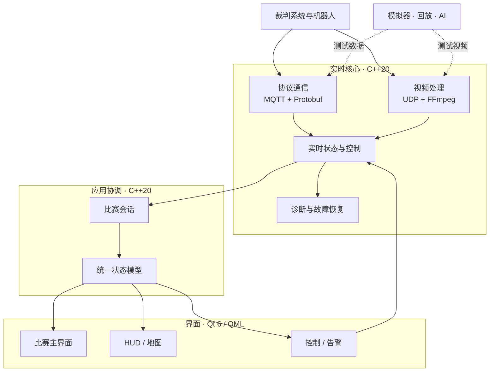

# PIP-Client 技术栈与模块架构

## 目标

PIP-Client 面向 RoboMaster 2027 正式比赛，优先保证高性能、高实时性、低延迟和长期稳定运行，同时保持界面易扩展、后端易读易维护。

协议以 [2027 V1.0.0（20261029）](protocol_2027.md) 为准。目前已有 Protobuf 定义、
C++ 代码生成、官方 MQTT 双向收发、校验及有界分发，详见 [数据链路](data_pipeline.md)。
欢迎页、赛事导航和接入配置已实现；业务字段映射、比赛状态模型和比赛 UI 布局仍待设计。
RMUL 已接入 UDP 重组与 FFmpeg 软件 HEVC 解码，控制模块仍为目标架构。

当前启动组合为 `DataPipeline`、`AppController`、`VideoReceiver`、`MatchSession` 和 QML engine。应用控制器只负责本地
初始化、RMUL/RMUC 选择、页面导航与显示偏好，不拥有或启动数据链路；QML 展示两者的
公开状态。MatchSession 接收导航与连接意图，校验网卡、身份和统一连接配置，并管理两条链路。
QML engine 先析构，随后会话停止注入链路，最后释放控制器及链路，避免悬空绑定。
详见[欢迎页实现](welcome_page_implementation.md)。

MatchSession 统一管理 VideoReceiver 的开始/停止；接收线程完成 UDP、组帧与解码，GUI 通过有界最新帧
邮箱更新 VideoView。QML 负责等比视频与 Esc 配置面板；同级 `businessOverlay` 使用窗口逻辑坐标，
不依赖视频尺寸或接收状态。目前业务叠层为空，展示快照与新鲜度模型仍待实现，
不能将 DataPipeline 的协议缓存或控制可用状态直接当作失联后保留的展示值。
具体资源、线程和协议边界见[图传接收](video_receiver.md)。

## 已确定技术栈

| 层级 | 技术 | 职责 |
| --- | --- | --- |
| 系统语言 | C++20 | 实时核心、通信、视频、状态、控制和系统能力 |
| 桌面框架 | Qt 6 | 原生窗口、桌面集成和跨平台能力 |
| 界面技术 | QML / Qt Quick | 比赛界面、HUD、地图和布局扩展 |
| 官方数据协议 | Protobuf 3 | 消息序列化与反序列化 |
| 官方通信协议 | MQTT | 比赛状态和控制指令传输 |
| 图传接收 | 原生 UDP | 接收官方图传码流 |
| 视频后端 | FFmpeg | UDP 图传处理、HEVC 解码、缓存、丢帧和异常处理 |

## 开发环境

- **目标平台**：Windows 与 Ubuntu，同等维护；硬件范围、后端适配和验收要求以
  [平台与硬件兼容约束](platform_compatibility.md) 为准。
- **主力 IDE**：JetBrains CLion，负责 C++20、CMake、实时核心、协议、FFmpeg、测试和调试。
- **Qt/QML 工具**：Qt Creator，负责 QML 页面、Qt Quick 调试和 Qt Kit 验证。
- **工具链**：Windows 使用与 Qt kit 匹配的 MinGW 或 MSVC，Ubuntu 使用匹配的 GCC 或 Clang；
  开发、CI 和发布在各平台统一依赖版本与 ABI，分别构建二进制。
- **CMake 生成器**：使用本机可用的 Ninja 或 Makefiles，机器专用路径保留在本地配置。
- **工具分工**：CLion 作为主要工程入口，Qt Creator 作为 Qt/QML 专项工具；两者使用同一套 CMake 工程和 Qt 配置。

外围的模拟器、回放工具和 AI 分析工具不属于正式比赛主链路，通过稳定的数据边界提供测试或扩展能力。

## 高层架构

当前客户端内部拓扑及服务端契约见[模块拓扑](design/client_topology_and_integration_checklist.md)，
本地已验证内容与外部未验证项见[接入验收](local_integration.md)。
下方实时控制、统一状态模型、HUD/地图等为后续目标架构，不表示已经实现。

## 本地文件架构

```text
PIP-Client/
├── CMakeLists.txt
├── cmake/                  # CMake 公共配置
├── src/
│   ├── main.cpp            # 应用入口
│   ├── app/                # 本地启动、偏好、导航和 MatchSession
│   ├── core/               # 双向 data_pipeline、官方协议表；原始控制尚未接入
│   ├── video/              # UDP 组帧、HEVC、接收会话与场景图视频项
│   ├── application/        # 核心模块与界面协调
│   └── platform/           # Windows / Ubuntu 及设备后端的适配边界
├── proto/                  # 2027 自定义终端收发消息
├── ui/                     # QML 页面、HUD、地图、控制和样式
├── resources/              # 配置、协议资源、图标和字体
├── tests/                  # 单元、集成、协议和夹具
├── tools/                  # 模拟器、回放和诊断工具
├── third_party/            # 固定版本第三方依赖
├── scripts/                # 构建、打包和检查脚本
├── docs/                   # 项目文档
└── build/                  # 构建产物，不纳入版本控制
```



## 模块职责

### 实时核心

- **协议通信**：封装官方 MQTT、Protobuf、主题、会话和消息收发细节。
- **视频处理**：负责 UDP 图传接收、分片重组、FFmpeg 解码、低延迟缓存和异常恢复。
- **实时状态与控制**：汇总比赛状态，管理控制输入和比赛指令。
- **诊断与故障恢复**：提供连接、数据时效、视频、性能和恢复状态。

### 应用协调

- **比赛会话**：管理当前比赛、队伍身份、操作角色和运行状态。
- **统一状态模型**：向界面提供稳定、易理解的状态，不暴露底层协议细节。

### 界面

- **比赛主界面**：呈现比赛核心信息和当前操作上下文。
- **HUD / 地图**：呈现视频叠加、机器人态势和战场信息。
- **控制 / 告警**：提供操作入口、状态反馈和异常提示。

## 设计原则

1. 视频、协议、状态、控制和诊断相互分离，避免底层细节扩散到界面。
2. 界面只依赖统一状态模型，不直接解析 MQTT 或 Protobuf。
3. FFmpeg 是正式视频后端，优先保证行为可控、延迟可测和部署一致。
4. 正式比赛主链路保持单体运行；模拟器、回放和 AI 作为外围能力接入。
5. 每个模块通过清晰接口协作，内部实现可以替换，便于测试和维护。
6. 先保证连接、状态、控制、视频和异常处理，再扩展战术分析等非核心能力。

## 主数据流

```text
裁判系统与机器人
        ↓
C++20 实时核心
        ↓
C++20 应用协调层
        ↓
Qt 6 / QML 界面
```

外围工具只用于测试、回放和扩展，不应影响正式比赛的核心通信、控制和视频链路。
