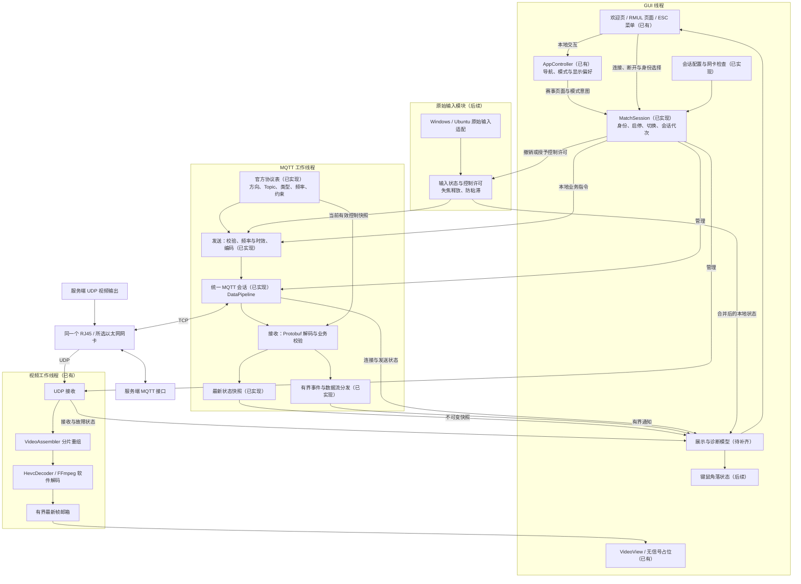

# 客户端模块拓扑与服务端接入清单

日期：2026-11-12。状态：比赛会话、双向 MQTT、网卡检查和有界分发已实现并通过本轮本机回归；
下文服务端清单仍是联调契约，官方服务端及物理 RJ45 未验证。结果见[本地接入](../local_integration.md)。

范围是比赛会话、官方 MQTT 双向接入以及同一 RJ45 下 MQTT/UDP 并行验证；
原始键鼠采集、正式业务 UI、3D 和推理不属于本次接入实现范围。
本文整理模块设计与联调契约；官方 proto 未增加私有字段。

## 1. 接入前提与依据

- 现场接入条件由项目负责人明确：每个操作手席位提供一个自定义终端 RJ45 接入口，
  电脑经此接入裁判系统局域网；MQTT 和 UDP 视频共用这根网线及所选以太网网卡。
- 官方网络、Topic、字段和频率以通信协议 V1.0.0（20261029）第 2 节为准，
  汇总见 [2027 协议说明](../protocol_2027.md)。
- 官方内部的交换机、席位地址隔离、MQTT 进程部署位置、UDP 发送源和身份路由机制，
  不通过客户端逻辑图自行推定。
- 自建服务器承担联调中的官方侧模拟。模拟通过不等于已经与官方设备互通。
- 下文英文配置名和诊断名是建议的本地工程契约，不是新增官方消息字段。

## 2. 客户端内部模块连接

标注“已有”的模块有代码，但不意味着全部正式业务已接入。“待补齐”描述现有能力的扩展。
图中会话连接为管理关系，网络及快照连接为数据关系；不是类之间全部互相持有。

### 模块职责与现有代码

| 模块 | 职责与连接契约 | 当前落点 |
| --- | --- | --- |
| AppController | 只管理本地导航、模式及偏好；把进入/离开比赛页的意图交给比赛会话 | `src/app/app_controller.*` |
| 比赛会话 | 唯一拥有接入意图和机器人身份；协调配置、启停、身份切换和旧代次失效 | `src/app/match_session.*` |
| 配置与网卡检查 | 验证整组配置和所选接口已有地址；报告故障，不自动改 OS；真实路由待实机 | `MatchSession`，500 ms 网络检测 |
| MQTT | 唯一实际 MQTT 连接；独占 socket、收发和重连；允许发布用途下无接收订阅 | `src/core/data_pipeline.*` |
| 官方协议表 | 精确 Topic 与生成消息类型对应；保存方向、频率和业务校验规则 | `src/core/protocol_catalog.*` |
| 接收分发 | 状态保留最新值；事件、CustomByteBlock 等走有界队列，溢出计数 | `DataPipeline::snapshot/takeEvents` |
| 发送路径 | 有类型的消息入口；检查方向、大小、频率与有效期；不离线缓存 | `DataPipeline::publish`，不开放给 QML |
| 视频 | 接收、组帧、解码并发布最新帧；不依赖 MQTT 订阅成功才显示视频 | `src/video/` 已有 |
| 展示与诊断模型 | 合并连接、消息有效性、视频状态；QML 不接触网络对象或解析 Protobuf | 现有各模块属性逐步整理，不强制合成一个巨大对象 |
| 原始输入与 HUD | 输入事件唤醒采集；安全状态控制发布资格；HUD 只读快照 | 后续接入 |

协调规则：

- 每个比赛会话只有一个 MQTT 连接。不能创建第二个相同 clientID 的连接来专门发送。
- 当前配置支持 0–64 个接收 binding，发布用途可以为零订阅，
  连接可用、必需订阅就绪、数据有效、控制启用应分别表示。
- RMUL 页面已由 C++ MatchSession 统一启停 VideoReceiver，
  界面只发意图，避免 QML 和会话同时启动或停止同一资源。
- MQTT 断开使其业务状态失效，但 UDP 仍有有效视频时继续显示；
  UDP 断流不自行销毁健康的 MQTT 连接。网卡断开分别使两条通信路径报告故障。
- 切换身份或会话前撤销控制、清理待发数据和旧快照。旧代次回调不能写入新会话。
- GUI 不进行网络、解码或逐个原始输入处理；线程之间只交换有界状态、事件或帧。
- 视频已有软件 HEVC 路径，本轮接入不新增 GPU/NPU 依赖；Windows/Ubuntu 分别验收。

## 3. 第 1 步：连接配置与身份清单

下面是配置数据，不是 MQTT payload。客户端统一为一套可编辑的连接配置，默认采用官方地址和端口；
本机测试或自建服务器直接修改同一表单，不设置正式/开发档。恢复官方默认只修改草稿。

| 建议本地字段 | 类型 | 官方接入值 | 自建服务器联调 |
| --- | --- | --- | --- |
| `competition_mode` | 枚举 | RMUL / RMUC | 同左；官方没有独立的模式握手 Topic |
| `network_interface_id` | 本地接口标识 | 选择席位 RJ45 对应网卡 | 选择测试网卡；标识不发给服务端 |
| `local_ipv4` | IPv4 | `192.168.12.2` | 显式选择所选网卡已有地址 |
| `broker_host` | 主机名或 IP | 默认 `192.168.12.1`，可编辑 | 填实际服务器地址 |
| `broker_port` | uint16，1–65535 | 默认 `3333`，可编辑 | 填实际服务器端口 |
| `robot_id` | 合法机器人编号 | 必须明确选择，不随机分配 | 服务端至少提供一个可用测试身份，例如 3 |
| `client_id` | MQTT 字符串 | 表示上述机器人 ID，不能用选手端 ID 替代 | 建议测试约定十进制文本，如 `"3"`；官方正文未明确字符串进制，实机需确认 |
| `video_bind_address` | IPv4 | 正式会话建议绑定所选网卡地址 | 同左；现有 0.0.0.0 监听兼容能力不能当成已限定网卡的证据 |
| `video_udp_port` | uint16，1–65535 | 默认 3334，按用户要求可修改 | 服务端必须向实际配置的目的端口发包 |
| `fragment_index_base` | 0 / 1 | 官方未写明；实机确认 | 首轮建议约定 0；这是兼容约定，不新增包头字段 |

服务端/网络环境还需提供：

| 项目 | 要求 |
| --- | --- |
| 服务端可达地址 | 真实监听 MQTT 的 IP/端口，TCP 路由及防火墙允许访问 |
| 客户端网络前缀 | 子网掩码/前缀长度由网络环境提供；文档未给出，不默认声称是 /24 |
| 网关/路由 | 仅在实际跨子网时提供；不要为了单网段联调要求凭空填写网关或 DNS |
| UDP 目的地址 | 明确配置终端所选 IPv4 和 UDP 端口，不能由一个标准 MQTT CONNECT 自动推导视频订阅 |
| 机器人身份映射 | clientID 与模拟机器人、队伍及对应视频源的关联表，首轮可仅一个身份 |
| 接入协议 | 建议首轮与项目当前实现一致：MQTT 3.1.1 / TCP；这是工程约定，非正文新增要求 |
| 认证 | 首轮封闭测试环境可约定无用户名密码、无 TLS；若测试服务器启用认证，另外提供要求与凭证，不能混称官方规定 |
| 控制来源 | 纯模拟阶段由模拟环境明确记录选择结果；真实设备需在官方侧选择键鼠来源，文档没有定义客户端设置该选择的 MQTT 字段 |

同一接口的实际使用需要验证 TCP 本地地址/路由和 UDP 绑定地址；
只显示网卡名称或检查网卡 `up`，不能证明两条通信都走所选网卡。
全通配 UDP 绑定只说明允许从多个本地接口收包，不代表只用了该 RJ45。

## 4. 第 2 步：MQTT 服务端最小能力

不必等待完整裁判业务逻辑。先用标准 MQTT Broker 加一个消息模拟程序，
后者使用项目同版本 proto 生成代码，即可完成首轮收发验证。
Broker 不需要自行实现 TCP/MQTT 协议。

### Broker 行为

| 能力 | 首轮要求 |
| --- | --- |
| 会话 | CONNECT / CONNACK，正确处理 clientID、断开与同 ID 重连 |
| 订阅 | SUBSCRIBE / SUBACK，精确大小写 Topic；能模拟拒绝必需订阅 |
| 发布 | 收发原始二进制 PUBLISH，支持 QoS 0、1；QoS 1 正确处理 PUBACK |
| 心跳 | 支持 PINGREQ / PINGRESP，能模拟连接断开、半开连接和服务重启 |
| 会话重建 | 首轮 clean session=true，客户端重连重新订阅；不保存过时控制命令 |
| retain | 测试端正常消息默认 retain=false；另外主动注入 retained 旧状态验证客户端处理。非官方新增规定 |
| 背压 | 能暂停消费、限制传输或中断连接，验证客户端队列有界且过期命令不补发 |
| 可观测性 | 记录连接身份、Topic、大小、接收时刻及解析结果；日志不记录凭证 |

最高 QoS 1 来自官方正文；附录示例默认 QoS 2 不作为接入要求。
PUBACK 只说明 MQTT 层交付，不证明模拟机器人或真实机器人执行。

### 必须提前明确的身份路由

标准 MQTT 不会因为两个订阅者 clientID 不同，就对同名 Topic 自动返回不同机器人数据；
普通订阅回调也不会自动携带原始发布者 clientID。

- 首轮最小环境采用一个终端/机器人身份，先验证单会话。
- 多席位联调时，服务器必须选择明确的身份感知路由实现，例如 Broker 接入钩子与路由模块，
  或每个席位隔离的虚拟 Broker/网络上下文；每个客户端在自己的上下文仍使用官方 Topic。
- 单纯给共用 Broker 配 ACL 可限制访问，但若 Topic 完全相同，ACL 本身不能隔离同名 Topic 的不同负载。
- 不用 `robot/3/...` 前缀或私有 `robot_id` 包装字段修补官方 wire 协议。
- 自建环境的身份路由实现必须记录为模拟约定，不能据此声称官方内部采用同一机制。

### 最小业务 Topic 集合

这里的“首轮要求”是测试覆盖选择，不把 proto 中 optional 字段擅自改成 required。
首次只需 5 个 Topic；其余 Topic 可先提供协议注册与离线向量校验，逐项加模拟数据。

| Topic | 客户端方向 | 频率 | 首轮提供内容 | 用途 |
| --- | --- | --- | --- | --- |
| `GameStatus` | 订阅 | 5 Hz | 下表 10 个字段 | 持续接收、字段存在性、变化及有效性 |
| `RobotStaticStatus` | 订阅 | 1 Hz | `connection_state`、`field_state`、`alive_state`、`robot_id` | 身份一致性及机器人状态 |
| `Event` | 订阅 | 触发 | `event_id`、`param` | 连续事件不被最新快照覆盖 |
| `CustomControl` | 发布 | 官方 75 Hz；首轮仅由隔离测试工具触发验证 | `data`，最多 60 字节 | 上行二进制发布、大小校验及来源日志 |
| `CustomByteBlock` | 订阅 | 50 Hz | `data`，最多 300 字节 | 下行二进制、流式吞吐及有界分发 |

CustomControl 首轮单条探测只是发布入口测试，不宣称验证了其完整 75 Hz 周期行为。
75 Hz 调度另外在隔离模拟环境做持续负载测试；不启用物理机器人动作。
CustomByteBlock 是字节流，不能默认按普通状态覆盖；具体业务格式继续留空，
测试向量仅存在于模拟工具和测试夹具。

### GameStatus 字段清单

全部字段均为 proto3 optional，编号和类型保持官方定义。

| 编号 | 字段 | 类型 | 首轮语义 |
| --- | --- | --- | --- |
| 1 | `current_round` | uint32 | 当前局号，从 1 开始 |
| 2 | `total_rounds` | uint32 | 总局数，与 current_round 一致合法 |
| 3 | `red_score` | uint32 | 红方得分，可随脚本改变 |
| 4 | `blue_score` | uint32 | 蓝方得分，可随脚本改变 |
| 5 | `current_stage` | uint32 | 0 未开始、1 准备、2 自检、3 倒计时、4 比赛、5 结算 |
| 6 | `stage_countdown_sec` | int32 | 当前阶段剩余时间，秒；测试负数的 wire 编码不代表宣布其业务有效 |
| 7 | `stage_elapsed_sec` | int32 | 当前阶段已过时间，秒 |
| 8 | `is_paused` | bool | 明确测试 false 和 true 的存在性 |
| 9 | `game_result` | uint32 | 非结算阶段 255；结算 0 平局、1 红胜、2 蓝胜 |
| 10 | `end_reason` | uint32 | 非结算阶段 255；结算按官方 1–7 枚举 |

### 身份、事件和二进制字段清单

| Topic | 字段编号与类型 | 首轮要求 |
| --- | --- | --- |
| RobotStaticStatus | `connection_state` #1 uint32 | 0 未连接、1 已连接；不是本机 MQTT 状态 |
| RobotStaticStatus | `field_state` #2 uint32 | 0 已上场、1 未上场 |
| RobotStaticStatus | `alive_state` #3 uint32 | 0 未知、1 存活、2 战亡 |
| RobotStaticStatus | `robot_id` #4 uint32 | 与当前选择身份相同；另提供不匹配故障向量 |
| Event | `event_id` #1 int32 | 建议用事件 1、2；完整含义按官方枚举 |
| Event | `param` #2 string | 如事件 1 的 `"1,101"`；短时间连续多条，不用自创事件编号 |
| CustomControl | `data` #1 bytes | 测试包含 0x00、0x80、0xFF 的二进制及 0/60/61 字节边界 |
| CustomByteBlock | `data` #1 bytes | 测试包含 0x00 的二进制及 0/300/301 字节边界 |

0 字节用例分别测试字段缺省与显式空值，不自行规定官方未写明的业务含义。
若测试双向闭环，模拟机器人收到 CustomControl 后产生 CustomByteBlock 是测试脚本行为；
官方未规定自动回显，也未规定两条消息互为 ACK。

### 下一批建议增加的消息

| Topic | 字段 | 目的 |
| --- | --- | --- |
| RobotDynamicStatus | `current_health`、`current_heat`、`remaining_ammo` 等完整定义见附录 | 10 Hz 最新状态及连续变化 |
| RobotStaticStatus | 剩余 #5–14 字段 | 静态能力、上限与业务校验，服务端无数据时保留缺省，不能编造数值 |
| RobotPerformanceSelectionCommand | `shooter` #1 uint32、`chassis` #2 uint32、`sentry_control` #3 uint32 | 触发式业务发送，最高 10 Hz；只在模拟环境验证 |
| RobotPerformanceSelectionSync | 同名同编号三个 uint32 字段 | 1 Hz 状态同步；不是携带 request_id 的专属 ACK |
| KeyboardMouseControl | 7 个官方字段，见附录 | 为下一阶段预留服务端解码；先接受全零中立测试向量，不采集真实键鼠 |

不新增官方未定义的 login、join、video_subscribe、heartbeat 或统一 ACK Topic。
不向官方消息添加统一 seq、timestamp、request_id、session_id 或赛事模式字段。
本地会话代次、收发时间、调试序号只留在本地状态或模拟器测试记录中。

## 5. 第 3 步：UDP 视频发送清单

服务端需要准备可解码的 HEVC 码流并按官方头格式分片发送；仅打开 UDP 端口不能提供视频。

### 发送器配置

| 本地测试配置 | 要求 |
| --- | --- |
| `destination_ipv4` | 客户端所选网卡地址；正式约定 192.168.12.2 |
| `destination_udp_port` | 默认 3334，必须与客户端实际配置一致 |
| `source_bind_address` / `source_port` | 测试端明确固定并记录；这是模拟发送器配置，官方未指定固定来源 |
| `video_source` | 可循环 HEVC 文件或编码器输出；这些路径只保存在本地测试配置 |
| `robot_video_mapping` | 多身份时由模拟服务器关联视频与身份，不添加 UDP 私有字段 |
| `fragment_index_base` | 首轮双方约定 0，另测 1；官方未定义起始值 |
| `target_fps` | 标准验证 60 fps；低分辨率/低帧率只用于调试，不能代替 1080p60 验收 |
| `payload_limit` | 每个数据报最多 1392 字节视频负载，整包最多 1400 字节 |

### UDP 数据报字段

| 字节偏移 | 字段 | 线格式 | 要求 |
| --- | --- | --- | --- |
| 0 | 帧编号 | uint16，大端 | 逐帧递增，覆盖 65535 → 0 回绕 |
| 2 | 帧内分片编号 | uint16，大端 | 每帧从约定起始值连续编号 |
| 4 | 当前帧总字节数 | uint32，大端 | 所有该帧分片填写相同值；只统计完整帧的视频负载 |
| 8 | 视频分片 | 1–1392 字节 | 按分片号拼接后恢复完整码流帧 |

### 码流契约及现有接收实现限制

- 官方要求 HEVC/H.265、1920×1080、60 fps。UDP 内不是 MP4、MPEG-TS 或 RTP。
- 当前 HevcDecoder 接口接收完整 Annex B HEVC 访问单元。首轮发送器按此提供码流，
  一个 UDP 帧编号对应一个完整访问单元；该封装细节是现有实现联调契约，官方实机还需确认。
- 提供 VPS/SPS/PPS 及可独立恢复的关键帧，循环文件时从有效随机访问点开始。
  首轮建议 8-bit 4:2:0、无 B 帧、SAR 1:1，明确色彩矩阵和范围；这些是测试码流选择，不是官方新增限制。
- 当前实现单帧上限 2 MiB、最多 4 帧在途、150 ms 组帧、每帧最多 4096 片；
  这些是工程资源保护值，不是服务端 wire 字段或官方默认值。
- 当前实现一次只锁定一个来源 IP/源端口，不混合两路视频。模拟器正常发送时保持来源稳定，
  另用来源变化测试故障恢复。端口独占、停包恢复和参数集重送均需验证。
- 不增加私有帧尾 CRC、时间戳、机器人 ID 或请求包；现有官方 UDP 头不包含这些字段。

## 6. 本地诊断字段

这些是客户端与模拟器各自的可观测字段，不上官方链路，也不作为新的业务 UI 布局。

| 范围 | 建议记录 |
| --- | --- |
| 会话 | 本地 `session_generation`、赛事模式、选择的 robot_id、预期 clientID、停止原因 |
| 网卡 | 接口标识、链路状态、本地 IPv4/前缀、实际 TCP 本地/远端端点、UDP 绑定端点 |
| MQTT | 连接状态、订阅状态、重连次数、最近错误、发送失败数、排队数/字节数 |
| 每个接收 Topic | 接收数量、解析/业务校验失败数、字段存在性、最近接收单调时间、是否属于当前代次 |
| 事件/流队列 | 深度、容量、溢出计数、消费进度；溢出必须可见，不能静默吞掉 |
| 视频 | 实际来源、数据报数量、完整帧/丢弃帧/解码错误、最后有效帧时间、实际分辨率及刷新率 |
| 服务端发布入口 | 连接上下文中的原始 clientID、映射 robot_id、Topic、负载长度、解码结果、接收时间 |

接收时间只证明数据何时到达本机，不能证明服务端何时生成。
不同机器的单调时钟不可直接相减作为单向延迟；若测端到端延迟，需另外同步时钟或使用可识别的画面测试。
测试工具可提供本地计数器/控制面，但不得把它们混入官方 Topic 或 payload。

## 7. 验收清单

| 场景 | 预期结果 |
| --- | --- |
| 选择网卡、连接 Broker、启动视频 | MQTT 和 UDP 实际使用指定 RJ45 接口；能看到两种协议流量 |
| 正常接收与发布 | 5 个最小 Topic 可按契约收发，二进制不经字符串转换；服务端有来源和解码记录 |
| optional 存在性 | 缺省、显式 0、false、空 bytes 可区分；没有数据不能显示为已知零值 |
| 错误身份 | RobotStaticStatus.robot_id 不匹配时明确报告；不能直接把不匹配数据当成本机器人数据 |
| 多身份 | 第一轮可暂不启用；声称多席位支持前必须验证数据和控制无串台 |
| MQTT 停止、UDP 正常 | 状态失效、控制不可用；有效视频继续显示 |
| UDP 停止、MQTT 正常 | 无信号/断流状态准确；MQTT 保持可用 |
| 拔网线再插回 | 两条路径分别报告并恢复；无旧会话状态、无补发过期控制 |
| Broker 重启及半开连接 | 能识别故障、受控重连、重新订阅；无需等待新业务数据才识别所有断开类型 |
| 订阅拒绝、发布失败 | 不报告全部就绪；失败可诊断，不能自动无限重试有副作用业务 |
| 事件连续到达 | 有界队列不把不同事件覆盖成最后一条；超载时计数并报告 |
| 畸形 Protobuf / 越界 bytes | 拒绝异常消息，保留明确有效性状态，不崩溃或无限占内存 |
| UDP 丢片、乱序、重复、冲突 | 不完整/冲突帧不进入正常显示；恢复到可解码关键帧 |
| UDP 帧号回绕、来源切换 | 有界资源下正确恢复，不拼接不同来源数据 |
| UI 卡顿和网络背压 | 收发/帧队列不无限增长；GUI 恢复后不重放大量过时状态 |
| 切换身份、返回欢迎页、退出 | 按策略停止资源，旧通知失效，端口可重新绑定，线程可退出 |
| 同网口并行负载 | 1080p60 视频与正常 MQTT 状态、75 Hz 模拟发布同时运行；记录实际收发节奏、CPU、内存和队列峰值 |
| Windows / Ubuntu | 分别构建和联调；缺少某平台实机时明确记录未验证，不把另一平台结果当成通过 |

建议首轮连续运行 30 分钟，并在测试期间重启 Broker、停发/恢复视频、执行拔插和身份切换。
30 分钟是工程验收建议，不是官方规定；发布前还需更长稳定性测试。
记录设备、操作系统、网卡、CPU、构建版本和码流参数；没有实测前不承诺端到端延迟或 CPU 数值。

## 8. 服务端最小交付包

1. 一个可连接的标准 MQTT Broker，提供 IP/端口、MQTT 版本、认证策略与测试 clientID。
2. 一个单身份消息模拟器：发布 GameStatus、RobotStaticStatus、Event、CustomByteBlock；
   接收并解码 CustomControl，记录与连接身份关联的上行结果。
3. 一个 UDP HEVC 发送器及可复现测试码流，提供目的地址/端口、分片起始值及参数集/关键帧策略。
4. 一份接入配置：客户端 IP/前缀、服务端地址、机器人身份、UDP 目的端点和防火墙条件。
5. 一套脚本或人工操作步骤，能够独立停启 MQTT/视频、注入坏消息和模拟网络中断。
6. 一份测试记录输出，能够区分 Broker 收到、模拟业务解析和模拟机器人处理，避免把 PUBACK 当执行成功。

无需先完成完整赛场仿真、全部机器人行为、地图、赛事 UI 或真实键鼠采集。
本地回环可验证消息格式，但第 3 步“同 RJ45”验收需要经过真实有线网络的两端环境，
不能用 localhost 测试替代拔线和网卡路由验证。

## 9. 完整官方消息字段索引

以下索引来自仓库两份 proto，用于后续服务器逐项扩展，不要求首轮全部产生业务数据。
字段类型、编号和 optional/repeated 必须保持一致；实际语义与限制仍以对应 proto 和官方原文为准。
RadarInfoToClient 外层有官方文档歧义，列出仅便于定位，不能作为已确认 wire 契约使用。
RadarSingleRobotInfo 是辅助结构，不是独立 Topic。

### 客户端发布字段

字段来源：[client_to_server.proto](../../proto/client_to_server.proto)。

**KeyboardMouseControl**

| 编号 | 字段 | 声明 |
| --- | --- | --- |
| 1 | `mouse_x` | `optional int32` |
| 2 | `mouse_y` | `optional int32` |
| 3 | `mouse_z` | `optional int32` |
| 4 | `left_button_down` | `optional bool` |
| 5 | `right_button_down` | `optional bool` |
| 6 | `keyboard_value` | `optional uint32` |
| 7 | `mid_button_down` | `optional bool` |

**CustomControl**

| 编号 | 字段 | 声明 |
| --- | --- | --- |
| 1 | `data` | `optional bytes` |

**MapClickCmd**

| 编号 | 字段 | 声明 |
| --- | --- | --- |
| 1 | `is_send_all` | `optional uint32` |
| 2 | `robot_id` | `optional bytes` |
| 3 | `mode` | `optional uint32` |
| 4 | `enemy_id` | `optional uint32` |
| 5 | `ascii` | `optional uint32` |
| 6 | `type` | `optional uint32` |
| 7 | `map_x` | `optional float` |
| 8 | `map_y` | `optional float` |

**AssemblyCommand**

| 编号 | 字段 | 声明 |
| --- | --- | --- |
| 1 | `operation` | `optional uint32` |
| 2 | `difficulty` | `optional uint32` |

**RobotPerformanceSelectionCommand**

| 编号 | 字段 | 声明 |
| --- | --- | --- |
| 1 | `shooter` | `optional uint32` |
| 2 | `chassis` | `optional uint32` |
| 3 | `sentry_control` | `optional uint32` |

**RuneActivateCommand**

| 编号 | 字段 | 声明 |
| --- | --- | --- |
| 1 | `activate` | `optional uint32` |

**DartCommand**

| 编号 | 字段 | 声明 |
| --- | --- | --- |
| 1 | `target_id` | `optional uint32` |
| 2 | `open` | `optional bool` |
| 3 | `launch_confirm` | `optional bool` |

**SentryCtrlCommand**

| 编号 | 字段 | 声明 |
| --- | --- | --- |
| 1 | `command_id` | `optional uint32` |

**CommonCommand**

| 编号 | 字段 | 声明 |
| --- | --- | --- |
| 1 | `cmd_type` | `optional uint32` |
| 2 | `param` | `optional uint32` |

### 客户端订阅字段

字段来源：[server_to_client.proto](../../proto/server_to_client.proto)。

**GameStatus**

| 编号 | 字段 | 声明 |
| --- | --- | --- |
| 1 | `current_round` | `optional uint32` |
| 2 | `total_rounds` | `optional uint32` |
| 3 | `red_score` | `optional uint32` |
| 4 | `blue_score` | `optional uint32` |
| 5 | `current_stage` | `optional uint32` |
| 6 | `stage_countdown_sec` | `optional int32` |
| 7 | `stage_elapsed_sec` | `optional int32` |
| 8 | `is_paused` | `optional bool` |
| 9 | `game_result` | `optional uint32` |
| 10 | `end_reason` | `optional uint32` |

**GlobalUnitStatus**

| 编号 | 字段 | 声明 |
| --- | --- | --- |
| 1 | `base_health` | `optional uint32` |
| 2 | `base_status` | `optional uint32` |
| 3 | `base_shield` | `optional uint32` |
| 4 | `outpost_R_health` | `optional uint32` |
| 5 | `outpost_R_status` | `optional uint32` |
| 6 | `enemy_base_health` | `optional uint32` |
| 7 | `enemy_base_status` | `optional uint32` |
| 8 | `enemy_base_shield` | `optional uint32` |
| 9 | `outpost_B_health` | `optional uint32` |
| 10 | `outpost_B_status` | `optional uint32` |
| 11 | `robot_health` | `repeated uint32` |
| 12 | `robot_bullets` | `repeated int32` |
| 13 | `total_damage_ally` | `optional uint32` |
| 14 | `total_damage_enemy` | `optional uint32` |
| 15 | `total_CP_ally` | `optional uint32` |
| 16 | `total_CP_enemy` | `optional uint32` |

**GlobalLogisticsStatus**

| 编号 | 字段 | 声明 |
| --- | --- | --- |
| 1 | `remaining_economy` | `optional uint32` |
| 2 | `total_economy_obtained` | `optional uint64` |
| 3 | `tech_level` | `optional uint32` |
| 4 | `encryption_level` | `optional uint32` |

**GlobalSpecialMechanism**

| 编号 | 字段 | 声明 |
| --- | --- | --- |
| 1 | `mechanism_id` | `repeated uint32` |
| 2 | `mechanism_time_sec` | `repeated int32` |

**Event**

| 编号 | 字段 | 声明 |
| --- | --- | --- |
| 1 | `event_id` | `optional int32` |
| 2 | `param` | `optional string` |

**RobotInjuryStat**

| 编号 | 字段 | 声明 |
| --- | --- | --- |
| 1 | `total_damage` | `optional uint32` |
| 2 | `collision_damage` | `optional uint32` |
| 3 | `small_projectile_damage` | `optional uint32` |
| 4 | `large_projectile_damage` | `optional uint32` |
| 5 | `dart_splash_damage` | `optional uint32` |
| 6 | `module_offline_damage` | `optional uint32` |
| 7 | `offline_damage` | `optional uint32` |
| 8 | `penalty_damage` | `optional uint32` |
| 9 | `server_kill_damage` | `optional uint32` |
| 10 | `killer_id` | `optional uint32` |

**RobotRespawnStatus**

| 编号 | 字段 | 声明 |
| --- | --- | --- |
| 1 | `is_pending_respawn` | `optional bool` |
| 2 | `total_respawn_progress` | `optional uint32` |
| 3 | `current_respawn_progress` | `optional uint32` |
| 4 | `can_free_respawn` | `optional bool` |
| 5 | `gold_cost_for_respawn` | `optional uint32` |
| 6 | `can_pay_for_respawn` | `optional bool` |

**RobotStaticStatus**

| 编号 | 字段 | 声明 |
| --- | --- | --- |
| 1 | `connection_state` | `optional uint32` |
| 2 | `field_state` | `optional uint32` |
| 3 | `alive_state` | `optional uint32` |
| 4 | `robot_id` | `optional uint32` |
| 5 | `robot_type` | `optional uint32` |
| 6 | `performance_system_shooter` | `optional uint32` |
| 7 | `performance_system_chassis` | `optional uint32` |
| 8 | `level` | `optional uint32` |
| 9 | `max_health` | `optional uint32` |
| 10 | `max_heat` | `optional uint32` |
| 11 | `heat_cooldown_rate` | `optional float` |
| 12 | `max_power` | `optional uint32` |
| 13 | `max_buffer_energy` | `optional uint32` |
| 14 | `max_chassis_energy` | `optional uint32` |

**RobotDynamicStatus**

| 编号 | 字段 | 声明 |
| --- | --- | --- |
| 1 | `current_health` | `optional uint32` |
| 2 | `current_heat` | `optional float` |
| 3 | `last_projectile_fire_rate` | `optional float` |
| 4 | `reserved` | `optional uint32` |
| 5 | `current_buffer_energy` | `optional uint32` |
| 6 | `current_experience` | `optional uint32` |
| 7 | `experience_for_upgrade` | `optional uint32` |
| 8 | `total_projectiles_fired` | `optional uint32` |
| 9 | `remaining_ammo` | `optional uint32` |
| 10 | `is_out_of_combat` | `optional bool` |
| 11 | `out_of_combat_countdown` | `optional uint32` |
| 12 | `can_remote_heal` | `optional bool` |
| 13 | `can_remote_ammo` | `optional bool` |

**RobotModuleStatus**

| 编号 | 字段 | 声明 |
| --- | --- | --- |
| 1 | `power_manager` | `optional uint32` |
| 2 | `rfid` | `optional uint32` |
| 3 | `light_strip` | `optional uint32` |
| 4 | `small_shooter` | `optional uint32` |
| 5 | `big_shooter` | `optional uint32` |
| 6 | `uwb` | `optional uint32` |
| 7 | `armor` | `optional uint32` |
| 8 | `video_transmission` | `optional uint32` |
| 9 | `capacitor` | `optional uint32` |
| 10 | `main_controller` | `optional uint32` |
| 11 | `modular_42mm` | `optional uint32` |

**RobotPosition**

| 编号 | 字段 | 声明 |
| --- | --- | --- |
| 1 | `x` | `optional float` |
| 2 | `y` | `optional float` |
| 3 | `z` | `optional float` |
| 4 | `yaw` | `optional float` |
| 5 | `robot_id` | `optional uint32` |

**Buff**

| 编号 | 字段 | 声明 |
| --- | --- | --- |
| 1 | `robot_id` | `optional uint32` |
| 2 | `buff_type` | `optional uint32` |
| 3 | `buff_level` | `optional int32` |
| 4 | `buff_max_time` | `optional uint32` |
| 5 | `buff_left_time` | `optional uint32` |

**PenaltyInfo**

| 编号 | 字段 | 声明 |
| --- | --- | --- |
| 1 | `penalty_type` | `optional uint32` |
| 2 | `penalty_effect_sec` | `optional uint32` |
| 3 | `total_penalty_num` | `optional uint32` |

**RobotPathPlanInfo**

| 编号 | 字段 | 声明 |
| --- | --- | --- |
| 1 | `intention` | `optional uint32` |
| 2 | `start_pos_x` | `optional uint32` |
| 3 | `start_pos_y` | `optional uint32` |
| 4 | `offset_x` | `repeated int32 [packed = true]` |
| 5 | `offset_y` | `repeated int32 [packed = true]` |
| 6 | `sender_id` | `optional uint32` |

**MapClickInfo**

| 编号 | 字段 | 声明 |
| --- | --- | --- |
| 1 | `is_send_all` | `optional uint32` |
| 2 | `robot_id` | `optional bytes` |
| 3 | `mode` | `optional uint32` |
| 4 | `enemy_id` | `optional uint32` |
| 5 | `ascii` | `optional uint32` |
| 6 | `type` | `optional uint32` |
| 7 | `map_x` | `optional float` |
| 8 | `map_y` | `optional float` |

**RadarInfoToClient（外层未确认，暂缓接入）**

| 编号 | 字段 | 声明 |
| --- | --- | --- |
| 1 | `RadarSingleRobotInfo` | `repeated uint32` |

**RadarSingleRobotInfo（辅助结构，无独立 Topic）**

| 编号 | 字段 | 声明 |
| --- | --- | --- |
| 1 | `target_pos_x` | `optional uint32` |
| 2 | `target_pos_y` | `optional uint32` |
| 3 | `is_high_light` | `optional uint32` |

**CustomByteBlock**

| 编号 | 字段 | 声明 |
| --- | --- | --- |
| 1 | `data` | `optional bytes` |

**TechCoreMotionStateSync**

| 编号 | 字段 | 声明 |
| --- | --- | --- |
| 1 | `maximum_difficulty_level` | `optional uint32` |
| 2 | `basic_state` | `optional uint32` |
| 3 | `putin_state` | `optional uint32` |
| 4 | `move_state` | `optional uint32` |
| 5 | `rotate_state` | `optional uint32` |
| 6 | `enemy_core_status` | `optional uint32` |
| 7 | `remain_time_all` | `optional uint32` |
| 8 | `remain_time_step` | `optional uint32` |

**RobotPerformanceSelectionSync**

| 编号 | 字段 | 声明 |
| --- | --- | --- |
| 1 | `shooter` | `optional uint32` |
| 2 | `chassis` | `optional uint32` |
| 3 | `sentry_control` | `optional uint32` |

**RuneStatusSync**

| 编号 | 字段 | 声明 |
| --- | --- | --- |
| 1 | `rune_status` | `optional uint32` |
| 2 | `activated_arms` | `optional uint32` |
| 3 | `average_rings` | `optional float` |

**SentryStatusSync**

| 编号 | 字段 | 声明 |
| --- | --- | --- |
| 1 | `posture_id` | `optional uint32` |
| 2 | `is_weakened` | `optional bool` |
| 3 | `is_powered` | `optional bool` |

**DartSelectTargetStatusSync**

| 编号 | 字段 | 声明 |
| --- | --- | --- |
| 1 | `target_id` | `optional uint32` |
| 2 | `open` | `optional uint32` |

**SentryCtrlResult**

| 编号 | 字段 | 声明 |
| --- | --- | --- |
| 1 | `command_id` | `optional uint32` |
| 2 | `result_code` | `optional uint32` |
