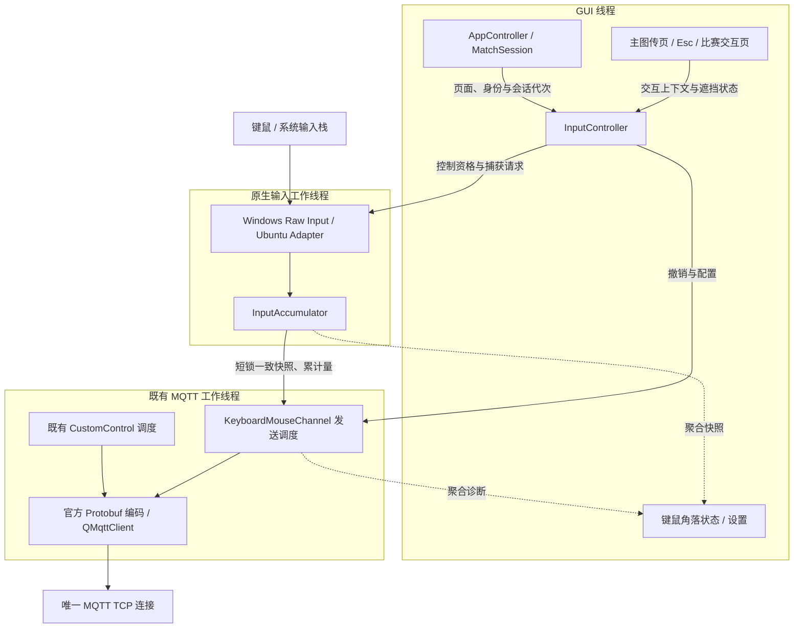

> 实现状态：本方案已进入产品实现，实际配置、后端与验证边界以
> [模块说明](../modules/keyboard_mouse_input.md)和[验证记录](../validation/keyboard_mouse_input.md)为准。
> 本轮按用户实现要求将默认发布设为 200Hz，保留 75Hz；原方案中的候选参数和未验证预算不等于性能结论。

# 键鼠控制整体架构设计

日期：2026-11-16。状态：实施前设计记录；以下候选方案和预算保留供追溯，当前实现以上方模块链接为准。
本设计以当时源代码、2027 通信协议
V1.0.0（20261029）、[工程规范](../CODE_STYLE.md)和[平台兼容约束](../platform_compatibility.md)
为基线。性能数值是待验收目标，不是现有产品能力。

## 1. 已确认需求与设计结论

用户已确认以下操作方式：

- MQTT 就绪、处于主图传页面、窗口未失焦、未打开 Esc 菜单或其他比赛交互页面时，自动捕获并持续发送。
- 条件不满足时退出捕获、恢复光标；条件恢复时自动尝试重新捕获。
- 鼠标无限相对移动，捕获期间隐藏光标；灵敏度可调；角落展示键鼠状态。
- 优先获取系统提供的原始输入，采集与发送尽量绕开 GUI；提出 200 Hz 采集及 MQTT 发布目标。
- 提高发布频率的目的是减少与裁判系统 75 Hz 处理周期错开的等待。

架构采用原生输入工作线程、共享输入状态和既有 MQTT 工作线程直接消费的方式。
硬件事件到达即处理，200 Hz 不作为原始事件读取上限；200 Hz 表示本地健康检查及可选发布周期。
协议不增加字段、Topic 或包装，不增加第二条 MQTT 连接，不重构已有视频通路。

发送频率保留 75 / 200 Hz 两种调度能力。200 Hz 是用户提出的候选目标；已知官方基线仍是 75 Hz。
本设计不把用户对延迟的推理当作官方支持 200 Hz 的证据，也不擅自将正式发送改为 200 Hz。
先确认接收处理和鼠标数值语义，再确定实际启用参数；无需为此新增正式/开发两套连接配置。

## 2. 频率与低延迟的真实约束

### 2.1 三种频率分别定义

| 频率 | 含义 | 设计 |
| --- | --- | --- |
| 设备报告频率 | 设备、USB、驱动交付事件的节奏 | 事件驱动读取；125/500/1000 Hz 等设备分别测量，不丢掉额外报告来强行降到 200 Hz |
| 本地检查频率 | 输入线程检查捕获资格、故障与存活的节奏 | 名义 200 Hz；无硬件事件时也检查，已有输入事件不等待检查点才交付 |
| MQTT 发布频率 | 生成并交付 KeyboardMouseControl 的节奏 | 参数化 75 或 200 Hz；发送器独占节拍，GUI 不产生逐周期请求 |
| HUD 更新频率 | 界面读取聚合状态的节奏 | 名义 30 Hz；不影响输入与发送，不逐事件刷新 QML |

200 Hz 周期是 5 ms；当前官方消息表规定 KeyboardMouseControl 为 75 Hz，周期约 13.333 ms。
工程使用向上取整的 13334 微秒作为 75 Hz 最短发布间隔，200 Hz 对应 5000 微秒。
提高软件检查频率不能让 125 Hz 设备产生 200 份不同的硬件数据；原始输入也不等于绕开驱动或 USB。

### 2.2 不能将 5 ms 作为机器人执行延迟上限

在网络无排队、接收端每次取最新值、线程立即得到调度的理想模型中：

`输入至消费等待 = 输入等待下一次发布 + 网络传输 + 等待接收端下一次处理`

| 发送与处理 | 发送侧理想最大相位等待 | 接收侧理想最大相位等待 | 两段相位等待的保守合计上界 |
| --- | --- | --- | --- |
| 75 Hz → 75 Hz | 小于约 13.334 ms | 小于约 13.333 ms | 接近 26.667 ms |
| 200 Hz → 75 Hz | 小于 5 ms | 小于约 13.333 ms | 接近 18.333 ms |

这些是独立相位等待的保守预算，不是任意固定相位下都会达到的数值，也不是 P99 的计算结果。
200 Hz 可缩短发送侧等待，并在接收取最新值时改善数据年龄；不能消除接收周期。
硬件报告、驱动、线程调度、TCP 队头阻塞、无线图传和机器人控制周期还会增加延迟。
系统不是硬实时系统，不能承诺绝对最大 5 ms、13 ms 或 18.333 ms。

### 2.3 200 Hz 的收益依赖下游处理方式

| 下游行为 | 200 Hz 的结果 | 必须核实的事项 |
| --- | --- | --- |
| 每个处理周期覆盖为最新状态 | 按键数据可能更近，但中间鼠标位移可能消失 | 鼠标量是速度还是每包增量；是否汇总全部输入 |
| 每周期只取 FIFO 中的一条 | 输入速率大于消费速率，队列和延迟可能增长 | 排队长度、淘汰策略及积压年龄 |
| 按接收时间拒绝超频包 | 实际有效频率取决于限频策略，可能发生非预期降频 | 是否丢包、断开、节流，以及窗口定义 |
| 接收所有包，75 Hz 周期汇总 | 可能改善输入覆盖，但不提升机器人控制更新率 | 增量累计、按键变更和转发策略 |

协议未定义足以确认上述分支的实现细节。MQTT Broker 接受 200 Hz 不代表图传和机器人接受 200 Hz。
禁止通过修改客户端限频数值就宣称已达到目标；必须观察最终消费结果。

## 3. 模块与线程

### 3.1 对外只新增一个输入模块

`InputController` 是 GUI 线程 facade，由 MatchSession 管理生命周期，窗口创建后显式绑定。
它接收完整上下文与设置、报告状态和诊断；不接收逐个鼠标移动，不做周期发布。
UI 不调用 DataPipeline::publish，不持有设备、系统句柄或 Protobuf。

输入模块内部的 Adapter seam 隔离实际存在的平台差异；内部状态与测试共用同一数据契约。
不引入全局输入总线、通用插件框架或为未来设备创建空抽象。

| 模块 | 所有者/执行线程 | Interface 契约 |
| --- | --- | --- |
| InputController | MatchSession / GUI | 绑定窗口、设置上下文、应用完整设置、停止；getter 只读快照，不执行原生采集 |
| 平台 Adapter | 输入工作线程 | 开始/结束捕获、处理事件与原生焦点、报告捕获确认/失效；句柄不出平台目录 |
| InputAccumulator | 输入写、MQTT 读 | 同锁取得按键、累计移动、捕获代次和健康；短临界区，无 I/O、Qt 对象回调或编码 |
| KeyboardMouseChannel | DataPipeline 当前传输代次 / MQTT | 绑定输入状态与发送参数、撤销、读诊断；不拥有第二条连接，不逐帧回调 GUI |
| HUD | QML / GUI | 读取本地采集与实际发送的聚合状态，不参与控制资格判断 |

### 3.2 高频路径

1. 原生线程醒来，先检查原生焦点和本地上下文，再批量读取系统事件。
2. 将事件折叠到持久按键状态及鼠标累计量；同时保存计数、时间和代次。
3. 从空闲变成有变更时，可合并唤醒 MQTT 线程；已经有唤醒或发送定时器时不逐事件投递。
4. MQTT 线程在合法时隙直接读取当前输入，编码并交给既有 socket。
5. 无输入变化时仍周期发送当前按键和零鼠标量；输入线程健康和捕获资格必须仍有效。

原始事件不走 QML、GUI 信号或逐事件 QObject 分配。先采用有界数据和短互斥锁；
锁外执行原生查询、Protobuf 编码与网络写出。没有争用测量依据时不引入复杂无锁结构。

现有视频的 UDP、解码、最新帧邮箱和独立呈交线程保留；键鼠不等待视频帧、vsync 或 HUD 同步。
MQTT 线程仍与接收解析共用事件循环，因此仍需测量大量状态消息对发送调度的影响。
若测量证明同步解析破坏预算，再将接收解码移到有界后台任务；不先拆第二条 MQTT 连接。

## 4. 原生采集与平台 Adapter

### 4.1 Windows：Raw Input 优先

- 在专用线程创建原生隐藏接收窗口与消息循环，使用 RegisterRawInputDevices 接收键盘、鼠标。
- 为隐藏目标使用 RIDEV_INPUTSINK，并使用 RIDEV_DEVNOTIFY 获取热插拔；后台可收到消息不等于允许控制。
- 每个原生事件批次以及发布资格检查均验证真实前台窗口属于主图传窗口；失焦即撤销本捕获代次。
- WM_INPUT 当前事件使用 GetRawInputData，随后可用 GetRawInputBuffer 排空积累事件；
  不能遗漏已被 GetMessage 从原始队列移除的当前事件。缓冲区复用并设置批次预算，防止 8000 Hz 设备饿死停止命令。
- 使用相对 RAWMOUSE 的 lLastX/lLastY，不使用桌面光标坐标差；绝对指针设备单独识别并明确报告能力。
- 使用扫描码、E0/E1 和 make/break 维护物理键状态，忽略自动重复；不使用 WM_CHAR 或输入法文本。
- Raw Input 不受 Windows 桌面鼠标速度设置影响，但设备 DPI、固件及驱动仍影响计数。
- 捕获时隐藏光标并限制光标活动区域；尺寸、DPI、显示器与原生窗口重建时更新或撤销约束。
  限制光标、隐藏光标与采集成功必须全部确认，失败则恢复资源并报告。
- 原始输入注册在进程内同一设备类别只有一个目标；启动前检查现有注册与 Qt 行为，禁止无声覆盖其他拥有者。
  不使用 RIDEV_NOLEGACY 作为默认方案，保留菜单、快捷键及正常 Qt 输入。

原生前台检查、隐藏接收窗和系统事件循环不得借用 GUI QObject。平台控制器根据绑定的原生窗口身份工作，
GUI 在窗口 surface 销毁前撤销借用并等待原生资源解绑；恢复时建立新窗口代次。

### 4.2 Ubuntu X11：XInput2

- 使用专属 X connection，输入线程独占该 connection 及其事件循环，不跨线程使用 Qt 的 X connection。
- 探测 XI 2.1+，读取 RawMotion 的未变换 valuator、原始按键/按钮和设备变更；
  按设备能力识别轴，不假定所有设备轴 0/1 都是同一种相对鼠标。
- 用 XKB 键映射规范化物理键，不能把 Windows 扫描码或任意 X keycode 直接当成协议位。
- 原始事件不受显示器边缘限制；另外执行指针捕获/限制与光标隐藏，失焦、grab 丢失立即释放。
- 只选择一层设备事件，处理 master/slave、模拟滚轮与高分辨率轴，避免同一动作重复计数。
- XInput2 原始事件可能在其他程序聚焦时仍到达，必须先检查资格，再进入 accumulator；非控制期间不保存输入历史。

该路径通常不要求读取 /dev/input 权限。XWayland 单列能力和实测结果，不能作为原生 X11 或原生 Wayland 的等价证明。

### 4.3 Ubuntu Wayland：相对指针与指针锁定

- 使用 relative-pointer 的未加速相对量和 pointer-constraints 的 lock_pointer，并接收同 seat 的按钮与键盘事件。
- Wayland 规范明确：未加速相对量不等于从设备读取的原始报告，不能标成与 Raw Input/evdev 完全相同的硬件计数。
- 锁定必须等待 compositor 的 locked 确认；申请成功不等于已经捕获。unlocked、leave、seat 消失均撤销发送资格。
- 不使用反复 warp 光标模拟无限移动；不承诺 compositor 不提供协议时仍可静默达到同等功能。
- 优先验证与 Qt 同一 wl_display 上的模块自有 proxy、独立 wl_event_queue 和输入线程派发。
  用 proxy wrapper 在创建阶段确定队列，不移动 Qt 已拥有的 pointer/keyboard proxy，不接管 Qt 默认队列。
- wl_surface 是 Qt 窗口借用对象，必须明确绑定、销毁前解绑、surface 重建、协议派发与 join 的先后关系。
  具体 Qt 6.12 原生 surface 获取方式封装在 Adapter；若确需私有接口，固定同版头文件并明确编译依赖。
- 同 display 多线程需要遵守 libwayland prepare_read_queue/read_events/cancel_read/flush 的协议。
  必须通过“GUI 阻塞 250 ms 仍持续收到键、按钮、相对移动”的原型验证，才可宣称采集独立于 GUI。

这是实现前的技术门槛，当前未证明该 Qt 集成已可用。若只完成 GUI 派发的协议路径，必须标为
gui_dependent 的功能回退，单独测量延迟；不能用它通过独立采集验收。
缺少必要协议时报告无法提供无限相对捕获，并保留客户端其他功能；可使用经过验证的 X11 会话。
原生 Wayland 仍是单独的实现与验收目标，不能将换会话当作其验收完成。

### 4.4 Linux 直接设备读取的定位

evdev 可在独立线程读取 EV_KEY、EV_REL 和 SYN_REPORT，是确有硬件原始报告需求时的可选 Adapter。
它需要设备访问授权，并不自动解决窗口焦点、光标锁定或 Wayland 的权限模型。
不以 root 运行整套客户端，不自动修改 input 组、udev 或设备权限，不把该授权作为 Ubuntu 基础功能前提。
若选用，必须处理 SYN_DROPPED 的重同步、设备移除，以及 REL_WHEEL 与 REL_WHEEL_HI_RES 的重复报告。
首轮不引入 evdev 权限安装程序；先完成 X11 与 Wayland 的原生路径和能力验证。

### 4.5 对外能力必须具体

诊断至少报告 backend、relativeMotion、motionSemantics、pointerLocked、guiIndependent、
deviceReportRate、captureConfirmed 和 unavailableReason。设备存在不代表已经捕获，
未加速相对量不代表硬件原始计数，发送线程独立也不代表输入采集独立。

## 5. 数据契约：按键状态与鼠标累计量

### 5.1 accumulator 的内容

共享快照采用同机 steady_clock 微秒，不与原生时钟或另一机器时钟直接相减。
原生事件时钟保留来源及转换信息；基准未校准时只测应用读出后的延迟。

| 数据 | 语义与约束 |
| --- | --- |
| transport_generation | 既有 MQTT 连接代次，断线即失效，重连不能复用旧通道 |
| capture_generation | 本次捕获代次；菜单、失焦、设备异常或窗口重建均递增 |
| context_revision | 页面、交互资格的版本；撤销后旧上下文不能重新授予捕获 |
| keyboard / buttons | 当前完整状态；各设备、左右 Shift/Ctrl 分别跟踪，合并输出协议状态 |
| total_x / total_y / total_wheel | 本捕获代次内累计相对量，内部保留足够精度，禁止每次读 HUD 时清零 |
| event_sequence / last_read_us | 本地已处理事件序号、应用读出时刻；不是硬件采样时刻 |
| health_checked_us | 输入线程最近完成健康检查的时刻；静止时持续更新，不能用最后操作时间判断失联 |
| capture_confirmed / fault | 原生捕获是否成立及失效原因；与 MQTT ready 分别判断 |

按下/抬起同一键来自多个设备时不能简单互相覆盖；移除设备应移除该设备贡献。
首轮按固定物理键位对应官方 16 位，不增加自定义按键映射编辑器；该项是设计选择，可后续按需求修改。
Esc、F11、Alt+Tab 等本地导航/系统快捷键不添加到官方按键位。

### 5.2 发送端采用累计水位

仅在“鼠标字段经联调确认采用每包增量”时，使用以下转换：

1. MQTT 线程读取一致快照，计算累计总量相对上次成功本地交付水位的差值。
2. 应用灵敏度、坐标方向和整数化，产生单个 KeyboardMouseControl；七个 optional 字段显式设置。
3. 再次检查连接与捕获代次，在短临界区接纳本次交付，随后锁外调用 QMqttClient。
4. 本地发布成功才推进水位和小数余量；限频跳过、可重试的本地拒绝不得提前消费移动量。
5. 捕获撤销、长停顿、背压或过期时丢弃旧累计量并重新基准化，禁止恢复后补发一大段转动。

水位只表示本地交付进度，不是远端 ACK，也不能弥补接收端主动丢弃的增量。
读快照和编码之间发生新输入时，该输入保留到下一次发送；正常合并快照不能丢失相对运动。
代次校验、接纳交付与撤销使用同一短临界区作为串行化点。接纳先于撤销的最多一帧可能仍在
交付途中或已经上网，不能承诺撤销它；撤销之后不得再接纳旧捕获数据。
接纳不是网络成功，累计水位仍以本地发布成功为准；发布失败不得因提前接纳而吞掉移动量。

### 5.3 鼠标字段语义是接入门槛

官方只称 mouse_x/y/z 为移动速度，给出方向和 int32 类型，没有提供足够的物理单位及时间换算定义。
因此内部同时保留累计量、采样起止时刻和原生单位，不把“每包位移”写成官方规定。

必须用机器人端/桥接实现或官方样本确认：

- 字段是每包增量、每个 75 Hz 控制周期的量，还是明确单位的速度；接收端如何积分。
- 75 与 200 Hz 下，同一段鼠标移动是否产生同一总转角；接收端丢弃中间包时如何处理。
- 静止必须立即回零；速度模式的估计窗口、零运动时效和时间基准需要单独定义。
- 不得把累计位移直接塞入鼠标字段要求接收端自行差分；官方协议没有这个契约。

该问题未解决前可以完成原生采集、HUD、编码与测试端联调，不能声称真实机器人手感已经正确。

### 5.4 灵敏度、方向与短按

- 第一版默认统一 X/Y 灵敏度 1.0，建议配置范围 0.05..10.0，无单位，整组有限值校验。
  保留小数余量，避免低灵敏度时反复取整吞掉细小移动；新捕获代次清零余量。
- 内部相对坐标先规范为右/下为正；官方 Y 负值向下，因此发送转换需反号。
  用户反转 Y 是独立于协议方向转换的偏好，默认关闭。
- 滚轮归一化为内部 120 单位/格，兼容高分辨率报告并保留余量；这是内部约定，不是官方 wire 单位。
- 使用宽类型做累计和缩放；编码到 int32 前校验并显式饱和计数，不允许溢出回绕或长期补偿饱和值。
- 同一段运动切换 75/200 Hz 后不应凭空改变总转角；不同 DPI/设备和 Wayland 量纲的手感单独标定。
- 默认发送当前状态，不自动把两次采样之间已经完成的短按延长为新的动作。
  短于发送周期的完整按下/抬起可能不可见；诊断计数并明确测试。
  如业务要求无损保留每次短按，必须另外约定边沿发送/脉冲策略与速率预算，不能假称状态协议天然保证。

## 6. 捕获资格与状态机

### 6.1 唯一资格表达式

`can_capture = 主图传路由 && 无交互遮挡 && 窗口可见且非最小化 && 原生焦点成立 && MQTT ready && 允许人工控制的角色 && 平台能力可用`

“主图传路由”按产品页面语义定义，当前为 RMUL 主视频页；不按 VideoView 是否收到图像判断。
RMUC 占位页不自动启用，未来有主图传页后复用同一语义。
视频断流本身不自动改变键鼠资格；是否增加“无图禁止控制”属于后续产品策略，不偷偷绑定到画面状态。
赛事/身份层必须遵守已有赛事适用结论，不能因支持 MQTT 就允许人工控制 RMUL 全自动哨兵。
确切角色白名单在实现时对照协议和规则确认，传输层不自行授予业务权限。

### 6.2 状态与转换

| 状态 | 进入条件 | 行为 |
| --- | --- | --- |
| inactive | 非主图传页、离线或角色不适用 | 不捕获、不周期发送，保留明确原因 |
| acquiring | 页面和连接条件具备，正在申请原生捕获 | 等待 Adapter 确认，光标/锁定失败不进入发送 |
| capturing | 原生捕获确认且所有资格满足 | 原速采集、按有效频率持续发送；无操作也发送零移动 |
| releasing | 原有捕获被撤销，当前连接尚可用 | 立即停止接纳该代输入，安排一次中立帧，恢复光标 |
| suspended | 菜单、比赛交互、失焦或最小化 | 不捕获，条件恢复后自动尝试新代捕获 |
| fault | 输入后端、设备或共享状态失效 | 撤销控制并报告，禁止静默继续发送旧按下状态 |

生效由 GUI 路由资格、原生焦点/捕获确认和 MQTT 工作线程资格共同决定；GUI 传入 true 不能覆盖原生失焦或网络失效。

### 6.3 页面和快捷键顺序

- 菜单与比赛交互页面统一通过 InputController 的交互资格入口登记。
  打开流程先撤销捕获资格，再打开 Popup；关闭动画和焦点恢复完成后才重新授予。
- 不能只依赖 Popup.opened，因为动画开始到 opened 之间可能仍在发送控制。
- Esc 的原始按下立即在输入线程锁存撤销，GUI 随后执行原有菜单动作；旧 GUI 上下文不得把它重新开启。
  GUI 处理该操作并发布新 revision 后才解除锁存，避免 UI 卡顿期间重新捕获。
- 系统失焦由原生后端直接处理，发送前再验证；不等待 QML 的 active 属性变化才释放。
- F11 切换或 surface 重建先释放，再绑定新 surface 并自动捕获；不得沿用失效的窗口矩形/句柄。
- GUI 在主图传页短暂阻塞时，原生输入与发送仍运行；如果此时按 Esc 或失焦，后端仍应及时退出捕获。

### 6.4 中立帧与恢复

撤销时先递增捕获代次、拒绝旧提交、清空鼠标累计与按键状态，再由 MQTT 线程为当前传输代次安排
一帧显式全零/false 的中立输入；该帧不携带旧代移动，不因恢复捕获被旧数据覆盖。
中立帧使用独立单槽，受同一键鼠频率预算约束，等待下一合法时隙；不绕过 75 Hz 限制。
本地等待寿命建议 20 ms，到期仍未交付则报告并停用该控制通道，不能无限等待。

MQTT 已断开或发生身份切换时不向新连接发送旧中立帧；重连建立新通道和全零基准。
新代捕获前排空后端旧队列并重同步物理状态，捕获前已按下的键/鼠标按钮默认抑制，直到释放并重新按下。
该行为防止菜单点击和编辑期间的按键进入机器人；不重放先前保持的按键。

恢复条件满足时自动申请；若 compositor 未确认捕获，保持 acquiring 并显示原因，不能假装已隐藏/锁定。
中立帧成功交给本地 TCP 不代表机器人已释放；真实机器人仍需输入超时保护。
网络断开时无法保证远端收到释放帧，客户端不能用本地状态冒充远端状态。

## 7. MQTT 集成、调度与过载

### 7.1 新增有类型的当前会话通道

DataPipeline 增加 KeyboardMouseChannel，直接绑定 accumulator 与当前 transport_generation。
其设计借鉴既有 CustomControlChannel 的生命周期隔离，但不复制串口逐帧 FIFO：

- 键盘保存当前状态，鼠标保存累计量，网络时隙读取最新值；不排 200 Hz 的逐帧请求。
- GUI 的通用 publish 保持现有接口；键鼠周期发送不通过 GUI publishFinished 决定下一帧。
- 一旦启用输入通道，拒绝其他来源同时发布 KeyboardMouseControl；通道独占该 Topic 的发送资格。
  中立帧及普通键鼠帧共享同一限频历史，不能通过换通道绕过频率限制。
- 原有 CustomControl 节拍、队列和协议规则保留；两个 Topic 的预算分别计算，网络背压共享。
- 不通过通用 is_official=false 绕过所有协议校验来实现 200 Hz。
  需要 200 Hz 时显式记录频率授权/联调参数，保持方向、类型、长度、QoS 等其余约束。

共享输入存储使用独立共享所有权，不借用 InputController 的 QObject 内存；通道关联传输及捕获代次。
GUI 的撤销入口先同步标记资格失效，再合并通知 MQTT 清理，不等待网络或逐周期结果。
接纳交付与资格失效使用同一短临界区串行化；临界区禁止编码、网络调用、信号回调或原生 I/O。
MQTT 线程先锁外准备编码，再锁内复核代次并接纳最多一帧，锁外立即调用 Qt MQTT。
撤销前已接纳的一帧可能在撤销后才交给 TCP，应单独报告，之后由同一工作线程交付中立帧。
这项有界在途行为必须通过竞争测试验证，不能用“发送前检查过一次”宣称绝对零在途输入。

平台 Adapter 独占句柄，MQTT 线程只读取值和生存状态。销毁通过失效标志及 join 收敛；
没有“QObject 已销毁但 worker 仍捕获 this”的异步回调。通道在 DataPipeline 销毁后可保留统计，
但不得继续投递工作对象；具体生命周期保护复用已有邮箱停止/代次机制，不裸借用工作线程指针。

### 7.2 发送时隙

- MQTT 线程独占定时器，复用 DeadlineTimer：Windows 高分辨率 waitable timer，Ubuntu 单调精确定时器。
- 名义周期分别为 13334 / 5000 微秒，以绝对单调截止时间计算下一次等待，不使用 GUI QTimer 或 sleep 轮询。
- 输入到达时若已到合法时隙，可合并唤醒立即发送；未到时只保留一次到期唤醒。
- 实际相邻发布不早于当前最短间隔。线程晚唤醒就发送当前最新值，并重新安排下一时隙；
  不连发补偿欠下的帧，不拿 CustomControl 的有限突发策略默认套到键鼠上。
- 该保守策略在调度抖动下实际频率可能低于名义值，必须报告实际 Hz、间隔和 missed deadlines，不能只显示设置值。
- 不使用忙等或实时进程优先级作为基础功能前提；优先消除 GUI 依赖、逐帧分配和排队。

### 7.3 有界性与新鲜度

- 共享输入只保留当前状态、累计量及固定容量设备表；合并唤醒最多一份，中立帧最多一份。
  设备表建议最多 16 个被选输入源，超额明确拒绝并计数，不能运行中无限增长。
- 本地捕获健康寿命建议 25 ms；输入线程即使没有按键事件也每 5 ms 检查并续期。
  超时撤销、清零并等待重新捕获，不重复发送失去可信来源的按下状态。
- 正常发布不积压历史采样，过载时跳过旧时隙。调度停顿超过健康预算后丢弃旧移动，禁止补偿突发转动。
- 延续 TCP LowDelayOption、QoS 0、retain=false；TCP 仍有重传与队头阻塞，不保证网络硬实时。
- 既有总待写上限 64 KiB 继续保留。新增键鼠通道建议另观察 4 KiB 待写阈值和 20 ms 无写出进展阈值；
  持续背压时撤销控制并按现有传输故障策略重连，避免已写入网络的旧控制不断堆积。
  这些是联调起始阈值，需要与串口并发实测，未验证前不直接写死到产品。
- bytesToWrite、socket 写进展、应用发布结果和 Broker/机器人消费是不同指标。
  已交给 Qt/TCP 的数据无法撤回，TTL 只能限制本地尚未提交的内容，不能标成远端过期保证。
- 停止先永久失效共享状态和来源通道，再唤醒并 join 输入线程，最后释放通道与网络拥有者。
  不持输入锁等待网络/GUI，不持邮箱锁 join 线程，不从 worker 同步等待 GUI。

## 8. 设置、HUD 与日志

设置沿用 AppConfigLocation，新增独立 input.json；原子保存、版本校验、整组应用，损坏不应用部分内容。
首轮产品设置提供灵敏度和可选反转 Y，不把平台句柄、内部时钟或实验参数堆到比赛操作路径。
捕获条件按用户要求自动判断，不额外增加每次手动启用按钮。
75/200 Hz 的配置位置和启用策略在接收语义确认后确定；诊断始终显示请求 Hz 与有效 Hz。

角落 HUD 挂到现有 businessOverlay，使用窗口逻辑坐标，字号遵循 UI 档位，不随视频分辨率缩放。
展示官方 16 键和鼠标三键的采集状态、简短运动反馈，以及捕获/暂停/连接状态；不拦截操作。
详细指标放入 Esc 诊断：backend、原始事件率、实际发布率、采样年龄、发布抖动、过载与撤销原因。
按钮亮起只能表示本地采集或本地已发布，不能表示机器人已执行；视图需明确选定口径。

聚合统计由 worker 更新，GUI 名义 30 Hz 读取，文件日志每秒记录；高频路径不输出逐键或逐包日志。
输入回放仅使用合成测试记录或明确开启的本地调试数据，不默认记录完整键盘历史。

## 9. 低延迟预算与验证

### 9.1 本机测量点

| 时间点 | 含义 |
| --- | --- |
| t_read | 应用读取到原生事件；不是硬件采样时刻 |
| t_commit | 该事件进入 accumulator |
| t_pick | MQTT 发送器读取到含该事件的状态 |
| t_submit | 编码完成并交给本地 MQTT/TCP |
| t_broker | 测试 Broker 接收到完整 PUBLISH |
| t_consume | 模拟器或机器人实际采用输入 |

所有本机阶段用同机 steady_clock；原生时间戳、Broker 时间和机器人时间未经同步不能直接相减。
同一机器的测试端可以用本地 sidecar 序号关联输入与输出，不向官方 proto 添加测试字段。
鼠标累计多事件、按键多次变化时分别记录事件被包含/覆盖情况，不能把无变化周期包算成新输入延迟样本。
远端需要时钟同步、回环或外部硬件测量，分别标明误差；禁止仅用 publish 返回时间证明端到端延迟。

### 9.2 初始验收目标

在指定设备、正常系统负载和原生独立输入路径下，目标如下，均待测：

| 项目 | 起始目标 |
| --- | --- |
| 应用读出到 accumulator | P99 ≤0.5 ms |
| 合法发送时隙的调度迟到 | P99 ≤1 ms，记录最大值及漏周期，不宣称硬上限 |
| 取样、转换、编码到本地交付 | P99 ≤0.5 ms |
| 应用读出到本地交付，200 Hz 候选 | 直接测量 P99 ≤7 ms |
| 应用读出到本地交付，75 Hz | 直接测量 P99 ≤16 ms |
| GUI 阻塞 250 ms | 原生采集和发布继续；Esc/失焦仍可撤销；HUD 允许延后 |
| 内存与队列 | 30 分钟压力下保持固定预算，无随事件数增长的队列 |

上述分位数分别测量，不能相加分阶段 P99 冒充总体 P99。开始实现前固定测试设备与测量方法；
达不到目标需记录哪段超时，不用“已使用原始输入”替代验收。
CPU 占用按相同硬件、视频配置及原始输入频率做开启/关闭对照；初始目标增量小于一个逻辑核的 5%，
必须注明分母，8000 Hz 等极端输入单列，不借此承诺所有机器的数值。

### 9.3 行为与协议测试

- 固定按键位、方向、optional presence、零值、边界整数、不同灵敏度和小数余量。
- 1000 Hz 输入分别以 75/200 Hz 读取，正常情况下累计移动不丢失、不重复；暂停/背压后不补发旧量。
- 两只键盘、左右修饰键、重复 make/break、设备移除、热插拔及绝对指针能力识别。
- 静止持续发送；健康超时与无操作分别处理；过期或故障不得继续发送按下状态。
- Esc、菜单动画、比赛交互页面、Alt+Tab、最小化、F11、DPI/多显示器和 surface 重建。
- 捕获/连接代次竞争、停止和发布提交交错、重连、身份切换、退出资源释放。
- 同一 Topic 多来源拒绝；键鼠与现有串口同时运行，两个发布频率和负载均正确。
- 按键短于发布周期的行为明确；不将被采样覆盖的边沿统计为成功送达。
- 四种接收端模型：最新值覆盖、逐条 FIFO、超频丢弃、周期累计；观察数据年龄、总运动和积压。

现有协议、MQTT、串口、会话、UI、视频与诊断测试继续回归。新功能测试从状态机、累计量和发送
Interface 验证行为，不依赖真实键鼠注入；平台捕获、驱动和 compositor 用实机验证。

### 9.4 平台与负载矩阵

| 维度 | 必须覆盖 |
| --- | --- |
| Windows | 原生桌面 Raw Input、窗口/全屏、前后台切换、DPI、多显示器及设备拔插 |
| Ubuntu | 原生 X11、原生 Wayland 分别验收；Wayland 协议缺失/锁定失败单独报告；XWayland 单列 |
| 键鼠 | 至少 125/1000 Hz，条件允许加入 500/8000 Hz；有线/无线和高分辨率滚轮分别标注 |
| 视频并发 | 1080p60，CPU 解码与可用硬解；核显、独显及无可用硬件加速分别测试 |
| 图形后端 | Windows D3D11/OpenGL、Ubuntu 原生可用后端；软件回退不遗漏控制功能 |
| 网络 | 回环、真实以太网、延迟/拥塞/停读/重连、MQTT 与 UDP 同接口并发 |
| 时长 | 30 分钟起始压力，多小时长稳作为正式实机验收 |

输入本身不依赖 GPU/NPU，NPU 不是采集后端；视频与可选推理并发的资源竞争仍须遵守硬件矩阵。
WSL、离屏和合成事件只能覆盖其实际验证范围，不能替代主桌面捕获、鼠标手感或真实图传链路。

## 10. 集成落点与实施顺序

以下文件是建议落点，当前尚未创建对应产品代码：

| 位置 | 计划职责 |
| --- | --- |
| src/input/input_controller.* | GUI facade、页面资格、设置与诊断 |
| src/input/input_accumulator.* | 按键/设备状态、累计移动、一致快照与捕获代次 |
| src/platform/input_windows.* | Raw Input、原生消息循环、焦点和光标约束 |
| src/platform/input_x11.* | XInput2、自有 X connection 和捕获资源 |
| src/platform/input_wayland.* | Wayland 协议、自有队列及 surface 生命周期 |
| src/communication/data_pipeline.* | 当前代次键鼠通道、发送调度和资格提交点 |
| src/app/match_session.* / src/main.cpp | 输入拥有关系、窗口绑定、模式/身份/停机协调 |
| ui/Main.qml / ui/settings/ / ui/components/ | 交互资格入口、灵敏度设置和只读 HUD |
| tests/input/ / tests/communication/ / tests/ui/ | 纯逻辑、模拟网络、会话和真实界面回归 |

不增加第二条 MQTT、不修改官方 proto、不把输入接进视频呈交线程、不以修改 AppController
承载设备采集。CMake 使用独立输入 target；Windows 链接 User32，Ubuntu 按实际 Adapter 引入
X11/Xi/XKB、Wayland client/protocol scanner 等依赖，选型时固定兼容版本并补齐许可与部署记录。

建议按四阶段实施，每阶段先建立行为测试，达到门槛后再扩展：

1. **语义与平台原型**：确认 75/200 Hz 接收语义和鼠标单位；验证 Raw Input、XInput2、Wayland
   独立队列及锁定，尤其验证 GUI 阻塞时的键盘/按钮，不只验证鼠标移动。
2. **核心状态与控制通道**：实现 accumulator、资格状态机、原生采集、原子撤销、周期发送和中立帧，
   用本机 Broker 覆盖 75/200 Hz，不接真实机器人动作作默认测试。
3. **会话与产品交互**：接入统一页面资格、灵敏度持久化、HUD、Esc/交互页面与窗口生命周期，
   完成 Windows/Ubuntu 构建和功能回归。
4. **性能与实机验收**：视频/串口/键鼠并发、真实网络和机器人端验证，记录延迟、运动总量、长稳和平台限制，
   根据证据决定实际启用频率及任何有条件降级。

当前阻断正式设计定案的外部信息只有：超频接收/转发规则、mouse_x/y/z 数值契约，以及真实目标
compositor/设备上的能力验证。其余模块划分、生命周期和测试可以按本文继续推进。

## 11. 依据与核对范围

- [2027 项目协议整理](../protocol/protocol_2027.md)：Topic、75 Hz、字段方向、最高 QoS 和当前原文歧义。
- [官方协议 PDF](../protocol/reference/RoboMaster%202027%20机甲大师高校系列赛通信协议%20V1.0.0（20261029）.pdf)：
  表 2-1、§2.2.1；键鼠字段及唯一控制来源约束。
- [现有数据链路](../modules/data_pipeline.md)、[串口模块](../modules/serial_controller.md)、
  [GUI/后端职责](../validation/video/gui_backend_separation.md)：已有线程、邮箱、限频和资源规则。
- [Windows Raw Input](https://learn.microsoft.com/en-us/windows/win32/inputdev/about-raw-input)：
  WM_INPUT、当前事件与缓冲读取顺序、高频事件处理。
- [RegisterRawInputDevices](https://learn.microsoft.com/en-us/windows/win32/api/winuser/nf-winuser-registerrawinputdevices)：
  进程内注册唯一性、热插拔与注册资源限制。
- [RAWMOUSE](https://learn.microsoft.com/en-us/windows/win32/api/winuser/ns-winuser-rawmouse)：
  相对量、绝对设备、桌面速度设置与滚轮粒度。
- [XInput2 协议](https://www.x.org/releases/current/doc/inputproto/XI2proto.txt)：
  RawEvent、未变换 valuator、XI 2.1 的 grab 行为与设备来源。
- [Wayland relative-pointer](https://github.com/wayland-mirror/wayland-protocols/blob/main/unstable/relative-pointer/relative-pointer-unstable-v1.xml)：
  相对运动、未加速量不是设备原始报告、焦点及按钮来源。
- [Wayland pointer-constraints](https://github.com/wayland-mirror/wayland-protocols/blob/main/unstable/pointer-constraints/pointer-constraints-unstable-v1.xml)：
  锁定确认、解锁和 compositor 决定生效条件。
- [libwayland client](https://wayland.freedesktop.org/docs/html/apb.html)：
  多线程事件队列、proxy wrapper、队列归属及读取协议。
- [Qt Wayland 原生应用接口](https://doc.qt.io/qt-6/qnativeinterface-qwaylandapplication.html)与
  [Qt Wayland 扩展接口](https://doc.qt.io/qt-6/qwaylandclientextension.html)：
  原生 display/seat 和 compositor 协议扩展入口；不证明本文专用队列方案已经验收。
- [Linux 输入事件](https://docs.kernel.org/input/event-codes.html)：
  evdev 事件、SYN_DROPPED、按键重复、高分辨率滚轮。

外部网页与协议源码在设计阶段只读核对，属于能力依据；设计阶段未运行 Adapter 或测试 200 Hz 服务端。
