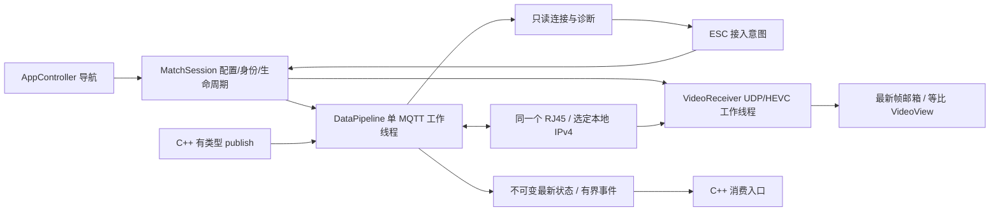

# 第 1～3 步本地接入与验收

日期：2026-11-12。范围：会话配置、官方 MQTT 双向传输、MQTT/UDP 并行与本机故障恢复。
自建服务器尚未完成，本轮仅使用测试进程中的本机 MQTT 对端和自产 HEVC 夹具。
不将回环测试记作官方裁判系统互通、物理 RJ45 路由或双平台实机验收。

## 入口与操作

1. 进入 RMUL 或 RMUC，Esc 打开“当前会话”。欢迎页不会自动连接 MQTT。
   RMUC 保留工作台占位，仅开放会话/显示/诊断；图传分区停用。
2. “正式接入”显示固定本机 192.168.12.2、Broker 192.168.12.1:3333；
   在系统中配置席位 RJ45 对应的以太网接口，再选择该接口及合法机器人编号。
   clientID 使用机器人编号的十进制文本，不使用选手端编号。
3. 自建服务器或本机调试选择“本地 / 开发”，选择网卡及其已有 IPv4，填写实际 Broker 地址和 TCP 端口。
   同机测试可用 127.0.0.1 回环接口；开发档与正式档分开保存，不覆盖正式端点。
4. 点击“保存并连接”，配置先校验、原子保存，再启动唯一一个 MQTT 会话并绑定所选源 IPv4。
   保存失败不打断旧会话。改机器人身份会重建连接、清除旧消息及待发命令。
5. 图传分区配置 UDP 端口（默认 3334）及工程分片兼容项。会话活动时视频地址与所选本地 IPv4 一致且只读。
   服务端应向该本机地址/端口推送官方封装 HEVC，不需要额外 MQTT 视频订阅或拉流请求。
6. 运行诊断显示实际 TCP 本地/对端端点、UDP 监听/来源、收发和丢弃计数。
   “地址可用”、MQTT ready、视频在线和控制许可是不同状态；当前控制显示“尚未接入”。

切换配置档停止旧 MQTT 和视频；新档须明确连接或开启视频。关闭菜单不应用编辑草稿。
返回欢迎页停止全部链路；进入 RMUL 可独立预览已保存的视频，不自动连接 MQTT。
仅视频预览允许原有 0.0.0.0 监听，建立比赛会话时才锁定所选 IPv4。
停止视频不影响 MQTT；断开 MQTT 不停止视频；用户暂停视频不会因 MQTT 重连或身份切换被取消。
会话设置位于 Qt AppConfigLocation/session.json（version=1），视频设置位于 video.ini。
程序不修改系统 IP、防火墙或系统路由。读取损坏配置不会应用部分解析结果，也不静默覆盖另一档。

## 实际模块关系



官方消息、限频、TTL 和有界队列契约见[数据链路](data_pipeline.md)。
服务端需提供的字段、席位路由和 UDP 封装契约见[服务端接入清单](design/client_topology_and_integration_checklist.md)。
测试对端仅实现 MQTT 握手、订阅确认及消息注入，不作为产品 Broker 或完整裁判系统模拟器。

## 自动化验收

正常配置并构建工程后执行：

```text
cmake --build <构建目录> --parallel
ctest --test-dir <构建目录> --output-on-failure
```

Windows 使用匹配 Qt kit 的编译器、Qt MQTT 与 FFmpeg；运行测试时 Qt/MQTT bin 需在 PATH 中。
GUI 测试由 CMake 设置 offscreen，使用产品 QML 与打包字体，不修改用户偏好。

| 测试 | 本轮验证内容 |
| --- | --- |
| protocol_2027 | 官方生成字段描述与固定 schema 清单一致 |
| data_pipeline | 零订阅发布、二进制及全零中立键鼠负载、方向/长度/身份校验、retained 拒绝、事件保留与有界溢出、QoS1 确认、限频、确认超时不重放、订阅拒绝/超时、断线清理、停止资源释放与重入切换 |
| match_session | 正式参数不可覆盖、开发档隔离、损坏/保存失败、五类最小状态、optional 的缺省/false、真实回环 TCP+UDP+HEVC 并行、分别停启、身份切换、清屏与端口释放 |
| video_assembler / video_receiver | 现有 UDP 乱序、丢片、坏包、来源锁定、超时、解码和负载下启停回归 |
| app_controller / welcome_ui | 现有导航、窗口/UI 档位、视频等比与菜单回归；新增正式字段只读、开发表单草稿和关闭不自动连接 |

本轮 Windows 11 / Qt 6.9.0 / MinGW 13.1 本地构建成功，CTest 7/7 目标通过；
clang-format --dry-run --Werror、qmllint 和 git diff --check 均通过。
断线、坏消息和等待确认超时由本机测试对端注入，不操作系统网卡或真实机器人。
Qt MQTT 的订阅拒绝用例会输出预期的拒绝诊断，不代表测试失败。

## 尚未验证或尚未接入

- 官方端点、认证要求、机器人 clientID 文本形式、席位隔离与同 Topic 身份路由；
  普通 Broker 不会只凭 clientID 自动将不同席位的数据分开。
- 真 RJ45 拔插/网卡改址、系统路由与防火墙、现场 UDP 来源及分片起点、官方 HEVC 流和长时间稳定性。
- 1080p60 视频与 75 Hz 输入持续并发下的延迟、CPU/内存、队列峰值及 30 分钟压力记录；
  当前故障回归不能替代这些性能验收。
- Ubuntu 构建、X11/Wayland 和驱动/硬件矩阵；新接入使用 Qt 跨平台网络/文件 API，仍须分别实测。
- 原始键鼠事件采集、防粘滞状态机、控制许可、角落键鼠 HUD、正式比赛字段 UI、硬件解码、3D 与模型推理。
  publish 入口已具备，但应用不会自动发键鼠或其他机器人动作；PUBACK 不当作动作完成。
- TLS/用户名密码尚未实现；当前开发环境应提供与本轮一致的 MQTT 3.1.1 TCP 接口。

本地 500 ms 网络检查只验证选定接口 up/running 且具有所选 IP；不会证明物理连接到裁判系统。
源 IPv4 显式绑定也不能替代多网卡、重复子网或现场网络的抓包验证。
