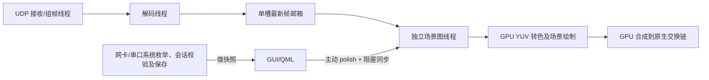

# 独立视频呈交与业务异步化

## 设计与范围

本轮在 `develop/p1ne4pp1e/gpu-video-pipeline` 实现产品级独立呈交，复用 Qt 6.12 / FFmpeg 7，
不新增 SDL 或厂商 SDK。`PresentationWindow` 替代根 `ApplicationWindow`，保留 QML 控件、
菜单、键盘、鼠标及窗口偏好；图形资源由专用 `video-presentation` 线程独占。



呈交线程不向 GUI 发送阻塞调用。GUI 忙时保留最后同步的 HUD 场景状态，视频节点在
`preprocess()` 中直接取得最新不可变帧引用；不会等待 `VideoReceiver::frameChanged`。
GUI 恢复后再同步菜单、HUD 数值及比例。邮箱只有一槽，消费者跳过过期帧；不累积视频事件。
保持显存/GPU 共享内存路径，不代表没有 GPU 内复制：现有 D3D11 共享桥仍会按能力复制纹理。
完整 QML 场景另需一张窗口尺寸 RGBA 离屏纹理及一次全屏 GPU 合成；没有常态 CPU RGBA
转换/读回。截图才显式读回最终交换链，并校正 RHI 坐标方向及 BGRA/RGBA 通道。

Windows D3D11 与 Windows/Ubuntu OpenGL 使用同一套 QRhi 实现；没有独显前置条件。
实际硬解/共享能力仍由现有设备探测及互操作决定。软件场景图、offscreen/minimal 和
未覆盖的 RHI API 保留 Qt 原循环，不能把这些回归通过当成独立 GPU 呈交验证。
使用固定 Qt 6.12 私有 RHI 头文件；升级 Qt 必须重编并重新验证。

## 线程、故障与业务约束

- GUI 只在主动同步时等待呈交线程；呈交线程不等待 GUI。GUI 停顿时 HUD 的动态数值冻结，
  已同步的控件和视频合成继续绘制；输入仍要等 GUI 恢复，独立视频不能消除所有 UI 卡顿。
- 窗口隐藏/最小化时停止呈交，接收和解码继续、邮箱有界；暴露后消费最新帧。原生 surface
  销毁前同步释放交换链和场景图，保留线程供下次重建。退出先断开唤醒，再回收 GPU、join。
- 初始化/设备/交换链失败发出 `presentationErrorChanged` 并记录诊断；每秒重建，连续三次
  失败后停止重试，通信与控制继续。错误发生期间图形输出可能不可用；不宣称已经完成
  驱动重置/物理 GPU 移除实机验收，也不承诺运行时切换到软件循环。
- 周期网卡检测、手动网卡/串口枚举在后台运行，GUI 只应用值快照。异步“保存并连接”
  在后台校验网络并原子写盘；重复请求拒绝。stop/离页取消连接意图，已接受的保存仍完成。
  失败保留旧配置和会话。配置代数隔离旧健康结果，单类系统查询忙时合并。
- C++ 保留同步会话接口供现有测试/显式调用，撤回其 QML 暴露；产品表单使用异步入口。
  轻量状态编排、QML 展示及已有少量本地偏好持久化仍在 GUI，不宣称“所有业务对象”已搬离 GUI。
  通信、协议、串口接收/转发和解码原本的后台执行不改成 GUI 驱动。
- OS 枚举不可强制取消，析构等待在途查询完成；驱动本身永久阻塞的退出边界未解决。

## 统计语义

`output.presentationLoop` 明确记录 `independent-rhi` / `qt`，运行时日志还包含
`independentPresentation`、`presentationError`，会话日志增加 `connecting`。

| 字段 | independent-rhi | qt 原循环 |
| --- | --- | --- |
| mailboxWait | 解码完成→呈交线程取邮箱 | 解码完成→GUI 取帧 |
| guiWait | 与 mailboxWait 相同，保留旧键兼容 | 解码完成→updatePaintNode |
| guiPrepare / renderWait | 无样本，显示 -1 | GUI 处理 / 请求刷新后调度 |
| texture | 纹理准备/共享桥 CPU 提交 | 同左 |
| presentWait | 纹理准备完成→交换链 endFrame 返回 | 纹理准备完成→Qt frameSwapped |
| receiveLocal | 同一已呈交帧首包读出→endFrame 返回 | 首包读出→Qt frameSwapped |

独立模式只在新视频帧成功呈交后记一次；重复 HUD 刷新不虚增 FPS。GPU 时间、DWM 合成、
显示扫描和物理亮屏均未测量。已呈交帧延迟低不能证明没有丢帧或长间隔，必须同时看输出
间隔、low、发送节拍和跳过的 AU 编号。诊断工具直接采集呈交线程值事件，GUI 停顿期间
仍能记录逐帧样本，不从 GUI 最新帧猜测已显示帧。

## 验证记录

测试环境为 Windows 11、NVIDIA GeForce RTX 4070 Laptop GPU、驱动 32.0.15.9579、
Qt 6.12.0 / MinGW；Linux 为 Ubuntu 22.04 / WSLg、GCC 11 和同版 Qt，使用验证用软件 FFmpeg。
本机未枚举出 Intel 核显，不能凭 NVIDIA 通过扩展硬件结论。

| 验证 | 本轮结果 |
| --- | --- |
| Windows Debug 全量构建、all_qmllint、CTest | 19/19，191.48s |
| Windows Release 全量构建、all_qmllint、CTest | 19/19，195.06s |
| Ubuntu 全量构建、all_qmllint、CTest | 18/18，149.82s |
| 最终增量回归（纹理、会话、界面） | Windows Debug/Release、Ubuntu 各 3/3，99.81s / 92.20s / 82.86s |
| Windows 原生 D3D11 完整界面 | 72 项通过，无跳过 |
| Windows 原生 D3D11/OpenGL 纹理矩阵 | 各 28 项通过，无跳过 |
| Windows 原生 OpenGL 核心界面专项 | 6 项通过，无跳过 |
| 最后显式排队唤醒变更，D3D11/OpenGL GUI 停顿/重建重验 | 各 4 项通过，无跳过 |
| WSLg Wayland/OpenGL 纹理矩阵 | 26 项通过、2 项硬解跳过 |
| WSLg Wayland/OpenGL 核心窗口专项 | 6 项通过，无跳过，GUI 停顿 250ms 继续呈交 8 帧 |
| 异步连接、取消、失败保留配置及网卡会话 | Windows/Ubuntu 各 14 项通过 |
| Ubuntu 安装暂存及运行库闭包 | 安装成功，移除开发 LD_LIBRARY_PATH 后从安装 lib 解析 Qt/FFmpeg/ICU，无缺失 |
| Windows Release 安装暂存与隔离 Qt 开发 PATH 启动 | 安装成功；创建真实 D3D11 窗口，运行 5s 后正常关闭，exitCode=0 |

普通 CTest 的图形测试为 offscreen/software，新增两个原生专项明确跳过；以上原生 GPU
专项单独运行且不跳过。Linux 的硬件输出子用例因软件 FFmpeg 跳过，不能算硬解通过。
Windows 安装启动日志确认 independentPresentation=true、presentationError 为空。

Windows 原生 D3D11 纹理矩阵已通过 28 项，覆盖 8/10 位 planar、NV12/P010、
BT.601/709/2020、全/限范围、负 stride、规格切换及真正硬解共享纹理。
最终交换链截图验证颜色/方向；原生 surface 连续重建三次及菜单输入通过。
首次小尺寸测试图在细节边缘采样出现 7/255 色差，改用平色位置并以完整人工平色矩阵
复核，没有放宽原断言容差。最终合成过程中另修复 D3D11 的纵向坐标约定。

早期 `independent_integrated_a` 性能运行与构建/回归重叠，排除在最终性能比较之外。
所有正式性能运行应在构建、格式和功能回归结束后串行进行，保留用户其他进程，不为跑分
停止用户的客户端或发送器。LOW_CHECK FAIL 是性能阈值未达标，与功能测试失败分开记录。

Intel Core i / Core Ultra 核显、AMD、混合显卡与原生 Ubuntu VAAPI 仍需实机验收；
WSLg OpenGL 可验证 RHI/Shader/线程逻辑，不能代替原生 Linux 驱动、VAAPI 共享和功耗验证。
短时窗口切换与资源重建不能证明长期稳定、驱动重置恢复、物理切屏或实际扫描延迟。

## 正式性能对照（2026-11-16）

所有构建与功能回归结束后串行运行，保留用户现有客户端和 FFmpeg 发送器，不将机器视为
独占空载。1080p60、HEVC 无 B 帧 GOP（240 AU），SHA-256 为
`8a3af4c879263d0cb1fdde2600aafc80fa9ece03f0ec3a7cd89166b455116ef1`。
Windows Release，NVIDIA D3D11VA→`d3d11-shared-yuv`，保留 QML/HUD、真实 UDP 和独立
精确发送器；165Hz/DPR=1 屏幕。运行末尾诊断的 CPU 下载/CPU RGBA 转色均无样本。没有开启计时策略守卫。
每阶段前后剔除 1.5s；low1 为稳定阶段最慢 1% 已呈交间隔均值的倒数，与产品滚动窗口不同。

| 运行 / OUT 1% low（fps） | 初始可见 | 失焦可见 | 完全遮挡 | 恢复前台 | GUI 阻塞阶段 | 阻塞阶段最大间隔/ms |
| --- | ---: | ---: | ---: | ---: | ---: | ---: |
| final_off：VSync 关 | 33.60 | 40.96 | 44.91 | 52.99 | 51.33 | 19.655 |
| final_replay：重放旧 GUI 查询，VSync 关 | 53.22 | 50.16 | 44.44 | 54.63 | 46.35 | 25.713 |
| final_on：VSync 开（产品默认） | 47.22 | 43.23 | 51.16 | 46.93 | 51.00 | 19.968 |
| configured_long：真实异步网卡、VSync 关，3 分钟 | 47.02 | 43.22 | 43.71 | 48.79 | 50.91 | 21.419 |

三组初始可见阶段实际均为前台，失焦/遮挡均由 OS 状态和原生中心命中验证。
可见阶段平均约 60fps；最小化按策略不呈交，恢复正常。四组功能均通过，**low1≥50 的全阶段
性能门槛均未通过**；重放行不能据此解释为比正常行更快，短时系统/驱动负载存在变化。
final_off 初始阶段跳过 1 个已显示 AU 间的编号，其余可见稳定阶段及另外两组为 0；
这不等于网络包损统计。

单独截取故意阻塞 GUI 的真实 250ms 窗口（含横跨边界的完整间隔）：

| 运行 | GUI 实际阻塞/ms | 阻塞期间呈交新视频帧 | 区间最大帧间隔/ms |
| --- | ---: | ---: | ---: |
| final_off | 250.185 | 15 | 17.107 |
| final_replay | 251.164 | 15 | 18.051 |
| final_on | 250.794 | 15 | 17.623 |

上一轮 Qt 原循环 Release 的同类 GUI 阻塞阶段最大间隔为 260.994ms，跳过 14 个 AU 编号；
本轮产品完整管线隔离了这一机制。该对照来自不同运行，不能据此宣称所有后台抖动均由 GUI
导致，也不能把原生无 UDP 工具的数字当作本轮产品结果。

final_off 恢复前台时首包→应用呈交平均 **1.003ms**、P95 **1.942ms**、P99 **2.739ms**、
最大 **3.200ms**。对应均值：首包→组帧/解码引用 0.268ms，解码→取帧 0.345ms，纹理准备
0.217ms；绘制回调 0.254ms（包含 preprocess，和纹理准备重叠），绘制后→呈交 0.141ms。
这些是 CPU 时钟区间，重叠段不能重复相加。开启 VSync 的恢复前台阶段平均 1.070ms、
P99 3.974ms、最大 8.087ms；不代表显示器在这些时刻完成亮屏。

剩余长尾可在取帧前和应用呈交间隔中观测到：例如 final_off 的 27.062ms 间隔中，该帧
解码→取帧为 7.758ms；39.158ms 最大间隔跨过一个 AU 编号。现有证据不能进一步区分
线程调度、驱动同步或合成器的全部贡献；本机此前 WPR 录制被策略拒绝，未取得 ETW/GPU
调度证据。本轮没有为达到 low50 隐藏失败样本或停止用户负载。

3 分钟 configured_long 运行（每阶段 30s）功能通过，记录 8934 个新视频呈交；
可见稳定阶段约 59.9–60.1fps，GUI 阻塞约 250ms 内仍呈交 15 帧，跨边界最大间隔 17.604ms。
稳定段跳过编号为初始 1、失焦 2，其余可见段 0；最大间隔 47.246ms，仍未满足 low1≥50。
持续运行、反复 GOP、最小化恢复和真实后台网卡检测未使管线停止，但本次只有约 3 分钟，
不作为多小时长稳、内存泄漏、GPU 内存/功耗或驱动恢复验收。

## 复现

先完成构建和功能回归，再运行以下命令；Qt kit 的运行环境由调用方配置，不提交机器路径。
所有测试使用临时产品偏好，不修改用户保存的垂直同步设置。

```powershell
python tools/run_video_presentation_probe.py --build-dir build/windows/qt612-release --stream .cache/archive/flat/latency_gop.hevc --output-dir .cache/gpu_pipeline/background_probe --name independent_final_off --stage-ms 8000 --precise-pacer
python tools/run_video_presentation_probe.py --build-dir build/windows/qt612-release --stream .cache/archive/flat/latency_gop.hevc --output-dir .cache/gpu_pipeline/background_probe --name independent_final_replay --stage-ms 8000 --precise-pacer --replay-network-poll
python tools/run_video_presentation_probe.py --build-dir build/windows/qt612-release --stream .cache/archive/flat/latency_gop.hevc --output-dir .cache/gpu_pipeline/background_probe --name independent_final_on --stage-ms 8000 --precise-pacer --vertical-sync on
python tools/run_video_presentation_probe.py --build-dir build/windows/qt612-release --stream .cache/archive/flat/latency_gop.hevc --output-dir .cache/gpu_pipeline/background_probe --name independent_final_configured_long --stage-ms 30000 --precise-pacer --configured-network
```

原始 JSON、QtTest 文本、stderr 和 `_summary.json` 位于调用方指定的未提交缓存目录，
本次对应上表的 `independent_final_*` 名称。测试工具的 `--vertical-sync` 默认 off 以保留
历史实验口径；on 使用产品临时偏好入口，结果日志确认 swapInterval=1，不把环境请求当成
实际显示扫描验证。
