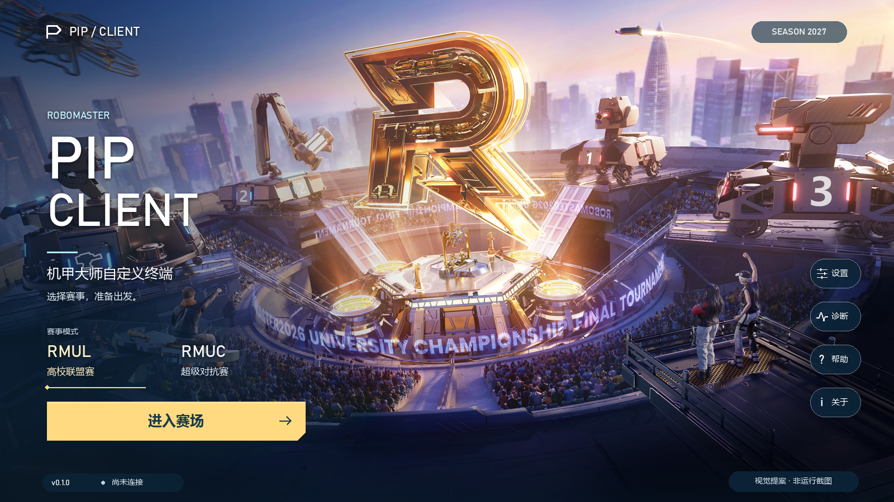

# 欢迎页与赛事模式选择设计

状态：第五版视觉提案，尚未替换实际 QML 页面。用户已选定官方 2026 全国赛纯净版，
以 5760 × 3240 高清赛场图为主视觉，沿用第四版布局。第一版深色面板和抽象场地线框方案已废弃。
本方案遵守 [平台与硬件兼容约束](platform_compatibility.md)。

## 1. 视觉与构图

背景铺满窗口，保留明亮天空、中央金色 R、未来城市、机器人和赛场。
中央金色 R 与右侧赛场为主要视觉，不覆盖大型卡片或工具面板。
左侧放置 PIP CLIENT 标题、中文副标题、开放式 RMUL/RMUC 选择和金色主按钮。
设置、诊断、帮助、关于改成边缘小入口，不与主按钮争夺注意力。

| 区域 | 内容与表现 |
| --- | --- |
| 全画幅背景 | 使用指定原图，按视口等比裁切；不带入网页文字和浏览器边框 |
| 左上 | 小型 PIP / CLIENT 标识，原图官方标识不作为本客户端品牌 |
| 左侧主体 | 大字号 PIP CLIENT、机甲大师自定义终端、简短引导 |
| 左下操作 | RMUL / RMUC 文字选项、中文名称与金色进入赛场按钮 |
| 右侧边缘 | 设置、诊断、帮助、关于，图标附简短中文标签 |
| 底部 | 构建版本与真实连接状态；提案水印不进入正式产品 |

窗口模式采用原生标题栏；全屏隐藏原生标题栏并提供可见的退出全屏入口。
样稿展示隐藏原生标题栏后的内容区；正式实现采用系统窗口管理，不自行模拟原生标题栏。
首次默认窗口模式，由用户明确进入全屏。

### 色彩与排版

- 保留原图色彩与天空亮度，不加全局灰黑遮罩或全屏模糊。
- 主文字白色，次文字浅蓝白；主按钮浅金色 `#FFDA80`，文字深蓝 `#183A4E`，呼应中央金色主体。
- 模式选项直接排在场景上，选中使用浅金字、短下划线与菱形标记；未选使用白字。
  不设置整组外框、整组矩形底板或分段控件底框。
- 只在左侧菜单、底部文字下面使用局部渐变遮罩，中央及右侧保持原始亮度。
- 样稿按 1600 × 900 绘制。正文建议 16–18 逻辑像素、次文字至少 14、点击区域至少 44 × 44。
  正式实现需重新布局，不能将整张样稿缩放当作界面。
- 使用 Qt 字体回退并分别检查两套系统的中文和英文宽度。样稿字体只用于栅格化，未分发字体文件。
- 正文对比度目标至少 4.5:1，焦点与边界至少 3:1，按实际背景合成后检查。
  若不足只增强菜单局部遮罩，避免再次压暗整个画面；选中不能只用颜色表达。

### 第四版：参考与细节修订

2026-11-11 直接检索并查看以下游戏实际界面。参考的是画面组织与操作层级，没有复制游戏图标、字体或素材。

| 参考 | 观察 | 本页采用方式 |
| --- | --- | --- |
| [Overwatch 2 主菜单 / Interface In Game](https://interfaceingame.com/screenshots/overwatch-2-main-menu/) | 左侧文字直接叠放在场景上，以字号和间距形成层级；主体画面保留较大空间 | 左侧布局保留，赛事选择改为开放文字，不再包入外框 |
| [Forza Horizon 5 菜单 / Game UI Database](https://gameuidatabase.com/index.php?&scrn=901&set=1&series=104&plat=1&autoload=47360) | 当前查看的入口菜单让风景占据主要画幅，按钮集中于角落，主动作有明确强调色 | 保持背景完整与一个金色主按钮，不引入其游戏内大量卡片式菜单 |

这是对查看截图的设计分析，不代表这些游戏所有版本和页面都采用同样样式。

- 删除上一版左下的大矩形底衬、描边、分段控件容器以及重复的“当前选择”文案。
  RMUL 与 RMUC 各用两行文字：英文缩写 + 中文名称。金色短线和菱形明确选中项。
- 主要区域位置不变，模式与按钮共享左侧对齐线；通过留白区分选择与进入两个动作。
  可见短线不限制点击范围，每个模式的点击区域应包含两行文字，至少 44 逻辑像素高。
- 将可读性处理移到背景层：菜单后方使用边缘连续羽化的局部深蓝渐变，无可见矩形边界。
  亮度在标题和操作范围内渐变，中央奖杯和右侧天空保持明亮；无需实时毛玻璃。
- 标题按实际字形可见左边缘对齐，避免字体内部留白造成错位；副标题采用稳定行框。
- 模式缩写共用视觉中线、中文名称共用另一条视觉中线，两个模式间距一致。
  不按字号估算实际高度，也不把所有字体设置为同一个 top 坐标。
- 主按钮文案按整个点击区域居中；右侧箭头保留等量对称空间，避免挤偏文字。
- 保留文字的轻阴影和右侧工具胶囊，保持已认可的整体布局。
- 静态样稿按字形包围盒校准；QML 应结合实际字体度量、布局及 DPI 检查，不能硬编码跨系统偏移。
- 悬停用轻微增亮，键盘焦点用局部焦点线，点击后移动金色选中标记；
  减少动效时立即更新。未选择时不画金色标记，进入按钮禁用，语义与已有设计一致。

样稿可用 [离线渲染脚本](design/render_welcome_mockup.py) 重现，需要 Pillow，显式传入
`--font-dir`、`--background` 和 `--output`。字体目录需含脚本声明的三种字体；
脚本不属于正式程序，也不分发字体。当前仅核对静态排版，尚未完成正式 QML 与动态背景对比度验收。

### 第五版：采用已选定高清背景

2026-11-11 用户选定官方 2026 全国赛纯净版。标题、赛事选择、按钮与右侧工具入口沿用第四版，
仅替换背景输入；保留局部渐变与文字轻阴影，中央金色 R、天空与右侧赛场保持明亮。
1600 × 900 样稿由高清原图缩小生成，原始 5760 × 3240 文件独立保留，不以样稿替代背景资源。
重现时 `--background` 使用 `docs/design/welcome_arena_2026_finals.png`，
`--output` 使用 `docs/design/welcome_page_game_v5.png`。

## 2. 赛事模式与工具入口

| 模式 | 中文名称 | 英文名称 |
| --- | --- | --- |
| RMUL | 机甲大师高校联盟赛 | RoboMaster University League |
| RMUC | 超级对抗赛 | RoboMaster University Championship |

- 两模式为平级入口，采用开放式文字选择，不使用大型信息卡片或整组外框。
- 首次无默认业务选择，按钮为“请选择赛事”；选中后为“进入赛场”，选项的短线和菱形标识当前赛事。
  样稿展示 RMUL 已选状态。可恢复上次选择，但不自动进入或连接。
- 点击进入只提交本地模式并创建对应容器，防止重复提交。失败回到原选择，提供原因和重试。
- 当前无比赛工作台，第一步容器只显示模式名称与返回入口，不伪造比赛数据、控制能力或连接表单。
- RMUL/RMUC 与协议版本分离，不自行推导 topic、字段、机器人配置或规则。
  不修改官方 proto，不设计 MQTT 地址、凭证、业务订阅和字段映射。
- 以后接入真实会话后，切换前必须结束会话、释放资源，不在活跃控制中直接改模式。

| 辅助入口 | 本期内容 |
| --- | --- |
| 设置 | 动效自动/开启/关闭、窗口/全屏、静态/轻动效背景 |
| 诊断 | 实际系统、应用/Qt 版本、可取得的渲染信息及初始化结果；未检查项明确标注 |
| 帮助 | 离线操作说明，附用户主动点击才访问的官方资料链接 |
| 关于 | 构建版本、项目归属、依赖许可、背景来源与署名 |

辅助入口打开局部浅色或半透明面板，一次只开一个，关闭后恢复焦点和原模式。
窄窗口改为右上菜单。没有需要时不铺满整页，不重新初始化背景。
不增加未实现的训练、回放、账号或云服务按钮；音乐和音效默认关闭。

## 3. 真实加载与动效

加载和欢迎共享背景，不强制播放片头，不额外要求“按任意键”。

| 状态 | 反馈与行为 |
| --- | --- |
| 首帧 | 静态背景优先出现，左下显示真实本地初始化步骤，不等视频或完整硬件枚举 |
| 初始化 | 不确定进度的细线指示器，不使用随机百分比或伪造的 GPU/MQTT 自检 |
| 就绪 | 左下淡入模式和进入按钮；必要步骤很快时直接显示欢迎态 |
| 选择 | 金色短线与菱形切换到当前选项，不重载整页 |
| 正在进入 | 主按钮显示“正在进入…”，阻止重复提交，完成本地页面创建后转场 |
| 初始化失败 | 显示原因、重试或使用默认设置入口，仍可关闭程序和查看诊断 |
| 背景失败 | 使用随包海报，海报也失败则使用明亮纯色底，保持模式选择可用 |

根 QML 创建失败需由启动层反馈，不能依赖加载失败的页面显示错误。
本页不建立 MQTT、UDP、串口或发送控制命令；“尚未连接”以实际链路状态为准。

动效建议：菜单淡入 180–240 ms，选择切换 120–180 ms，进入转场 160–220 ms。
图片可做 12–18 秒周期、约 1% 的轻微缩放；不添加持续鼠标视差、大幅摇镜或伪造的复杂 3D 分层。
减少动效时关闭循环背景；静态构图必须完整。后续若取得同风格场景短片再替换背景。

## 4. 背景来源

本版使用用户选定官方高清原文件，未进行 AI 重绘、锐化或改变品牌标识。

- 官方入口：[组委会品牌宣传包](https://bbs.robomaster.com/wiki/20204847/810999?source=7)。
- 下载包：[RM2027电子宣传礼包](https://pan-sec.djicorp.com/s/jseHa7iiNGqWGEi)，
  路径为 `06.赛季赛事kv / 26全国赛 / RoboMaster 2026全国赛KV-纯净版png.png`。
- 本地原文件：[2026 全国赛高清背景](design/welcome_arena_2026_finals.png)，
  5760 × 3240 PNG，24,178,841 字节，保持下载文件原样。
- 样稿：[第五版欢迎页](design/welcome_page_game_v5.png)，1600 × 900。
- 取得与选定日期：2026-11-11。背景属于 2026 赛季，样稿的 SEASON 2027 为客户端目标赛季，
  不代表这张图是 2027 官方主视觉。背景内原有赛季文字保留。
- 礼包注明仅限战队宣传、禁止商业化使用及品牌标识变形变色；当前仅用于设计评审，
  未加入应用资源或发布包，正式分发前确认适用范围。

完整来源与备选见[官方高清静态与动态素材核查](design/official_background_research.md)。
第四版使用的 [800 × 400 旧图](design/welcome_arena_reference.png)和
[旧样稿](design/welcome_page_game_v4.png)保留为历史记录；
[AI 增强提示词](design/welcome_arena_enhance_prompt_zh.md)不再作为当前背景方案。

上一版通用电路视频与抽象线框不再推荐。后续动态素材沿用明亮赛场方向，
记录最终原片来源、授权、尺寸、循环方式和处理过程。不擅自从视频网站搬运宣传片。

## 5. 跨平台实现与验收

- 首期采用本地图片和少量 Qt Quick 变换，无需实时 3D、WebView、NPU 或厂商 SDK。
- Intel 核显与 NVIDIA 使用相同基础画面，不因存在独显就自动增加高负载特效。
- 异步加载背景期间先显示随包海报或底色，操作控件不依赖背景加载成功。
- 静态模式无持续动画；最小化、不可见或离开页面时停止动效并释放不再使用的纹理和计时资源。
- 日后视频按现有 FFmpeg 方向评估，本地短片、无音轨、单解码器和静态回退；
  不为欢迎页另起视频后端，不在启动时联网拉背景。两平台分别验证解码与部署。
- 设置使用 Qt 跨平台 API，只保存已实现的模式与显示偏好，未知值/损坏配置回退默认并记录原因。
- 应用层提供模式、初始化、配置、版本和诊断，QML 负责展示与交互，保留现有 dataPipeline 契约。
- 常规支持 1280 × 720 及以上；拟定最小逻辑尺寸 1024 × 640。
  小窗口优先缩减标题、装饰与边距，不牺牲点击目标；宽屏优先保留中央金色 R，不拉伸图像。
- 分别检查 Windows 125%/150%/200%、Ubuntu 字体缩放与适用的 X11/Wayland。
- 支持 Tab/Shift+Tab、模式左右键、Space 选择、Enter 激活。
  Esc 优先关闭面板再退出全屏，不直接退出程序；图标具备可访问名称，焦点始终可见。
- 自动验证覆盖无选择、恢复选择、两模式进入/返回、防重复进入、设置保存及配置损坏恢复。
- 故障检查覆盖断网、图片缺失、初始化失败、最小化恢复和动效回退。
- 拟定目标：启动至可选模式 2 秒内、选择反馈 100 ms 内。实现前指定参考机、分辨率、
  CPU/GPU/内存预算和测量方法；当前没有实测结果。
- 双平台及目标核显/独显分别验收构建、部署、字体、缩放、交互和资源释放，缺少环境标为未验证。

实现顺序：静态背景与菜单 → 模式导航和工具面板 → 轻动效与性能检查 → 可选场景视频。
本轮只完成设计，没有修改 Main.qml、协议和业务链路。
